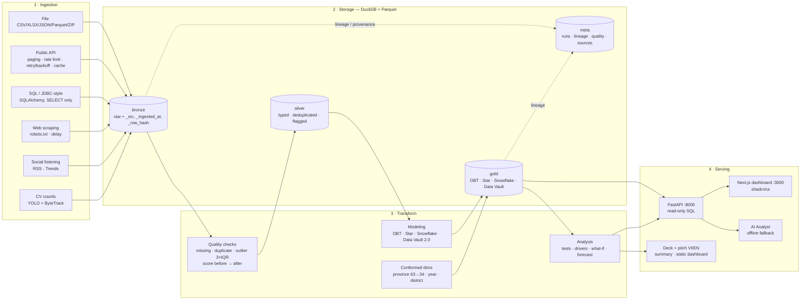

# VietLeap Insight Kit — From Data to Decision

[](https://github.com/ducvuathuduc/vietleap2026/actions/workflows/ci.yml)
[](https://github.com/ducvuathuduc/vietleap2026/actions/workflows/security.yml)
[](LICENSE)
[](requirements.txt)
[](web/package.json)

**Bộ theo dõi tài chính Việt Nam** xem vốn đang chậm ở đâu trên đường từ nguồn thu đến chi tiêu, đầu tư và tăng trưởng, và cơ quan nào cần rà soát trong quý tới. Phiên bản này theo dõi ngân sách, FDI, ngân hàng, thị trường vốn và bất động sản, với so sánh ASEAN và dữ liệu địa phương. Kit phân tích dữ liệu theo đề bài vẫn dùng được cho thử thách khác.

Bộ công cụ mã nguồn mở cho **VietLeap Hackathon 2026 — From Data to Decision** (UEH School of Public Finance × AVSE Economic Policy Network),
chạy được trên laptop 2 CPU / 7 GB RAM, offline khi không có khoá LLM.

> English summary: [below](#english-summary).

## Mục lục
[Tính năng](#tính-năng) · [Kiến trúc](#kiến-trúc) · [Bắt đầu nhanh](#bắt-đầu-nhanh) · [Cách dùng](#cách-dùng) · [Cấu trúc thư mục](#cấu-trúc-thư-mục) ·
[Nguyên tắc Data Engineering](#nguyên-tắc-data-engineering) · [Nguyên tắc phân tích](#nguyên-tắc-phân-tích) · [Bảo mật](#bảo-mật) · [Kiểm thử & CI](#kiểm-thử--ci) ·
[Lộ trình](#lộ-trình) · [Đóng góp](#đóng-góp) · [Giấy phép](#giấy-phép) · [Ghi nhận](#ghi-nhận)

## Tính năng

Sáu mục dành cho giám khảo gồm Tổng quan (`/`), Chỉ số & ASEAN (`/asean`), Ngành (`/nganh/[sector]`), Tỉnh thành (`/tinh` và `/tinh/[code]`), Phân tích & Khuyến nghị (`/khuyen-nghi`), Dữ liệu & Phương pháp (`/phuong-phap`). Mục Ngành gồm tài chính công, FDI, ngân hàng, thị trường vốn và bất động sản. Các trang đọc bản công bố `monitor.json` trên máy chủ.

Nguồn gồm FiinQuant, World Bank WDI, Cục Thống kê, Ngân hàng Nhà nước, phụ lục công bố của Quốc hội và Bộ Tài chính, báo cáo ngành và tin RSS. Các điều kiện công bố, kỳ dữ liệu và quy tắc cảnh báo được ghi trong [Danh mục nguồn](docs/DATA_SOURCES.md) và [Quy tắc nghiệp vụ](docs/BUSINESS_RULES.md).

- **Ingestion 8 loại nguồn** — `file` (CSV/XLSX/JSON/Parquet/ZIP), `api` (phân trang, rate limit, retry + exponential backoff, cache đĩa), `sql` qua SQLAlchemy (chỉ `SELECT`), `scrape` (tôn trọng robots.txt, có delay), `social` (RSS, Google Trends tuỳ chọn), `cv` (số đếm YOLO + ByteTrack, tuỳ chọn), `reducto` (PDF/scan qua API, tuỳ chọn), `tinyfish` (agent browser cho trang JS/403, tuỳ chọn).
- **TinyFish (`kind: tinyfish`, tùy chọn)** — hỗ trợ trích xuất từ trang có JavaScript khi nguồn cho phép. Tôn trọng robots.txt và điều khoản của nhà xuất bản. Lưu bộ nhớ đệm và nhật ký chi phí tại `data/cache/tinyfish/`. `TINYFISH_MAX_USD` giới hạn chi phí và TinyFetch hỗ trợ đối chiếu số trích với văn bản nguồn.
- **Storage medallion** — DuckDB `bronze / silver / gold / meta` + Parquet lake; bronze giữ dữ liệu thô kèm `_src`, `_ingested_at`, `_row_hash`.
- **Transform** — làm sạch theo kiểu số/ngày Việt Nam, missing / duplicate / outlier (3×IQR, **gắn cờ, không xoá**), điểm chất lượng 0–100 trước/sau, nhật ký làm sạch; tự dựng **OBT, Star schema (Kimball), Snowflake, Data Vault 2.0** + ERD; conformed dimensions nhiều nguồn (tỉnh 63 → 34 theo NQ 202/2025/QH15, năm, quận/huyện) kèm độ phủ ghép nối.
- **Phân tích** — hồ sơ dữ liệu (EDA), so sánh nhóm (Kruskal–Wallis / Mann–Whitney + effect size), tương quan Spearman có hiệu chỉnh Bonferroni + tương quan riêng phần, drivers (Ridge + gradient boosting, CV 5-fold, permutation importance), what-if có khoảng bootstrap 90%, phân khúc k-means, dự báo có khoảng 80% và MAE holdout.
- **Quyết định** — "So what → Now what" kèm tác động ước tính và mức tin cậy; đề bài → `brief.json` (câu hỏi, biến mục tiêu, người quyết định, KPI) mở đầu deck và câu chuyện.
- **Công bố** — Next.js 16 và shadcn/ui cho bộ theo dõi. Kit dùng FastAPI (OpenAPI), các trang nội bộ `/lab`, trang HTML tĩnh và tóm tắt điều hành MD/HTML/PDF.
- **AI Analyst & "Hỏi AI"** — Vercel AI SDK với tool chỉ đọc; Groq hoặc mọi endpoint OpenAI-compatible (kể cả Ollama cục bộ); **chế độ offline** trả lời bằng số do engine tính; câu chuyện insight có kiểm tra số chống bịa.
- **Deck & pitch song ngữ** — `deck.pptx` (EN) / `deck.vi.pptx` (VI) và `pitch.md` (VI, Marp) / `pitch.en.md`, chọn bằng `--lang vi|en|both`; chuỗi cố định do người viết và duyệt (không dịch máy), hai ngôn ngữ mang cùng con số.

## Kiến trúc



Chi tiết: [`docs/SPEC.md`](docs/SPEC.md) · luồng nghiệp vụ và ánh xạ 6 bước của mentor: [`docs/WORKFLOW.md`](docs/WORKFLOW.md) · kế hoạch tổng: [`docs/MASTER_PLAN.md`](docs/MASTER_PLAN.md).

## Bắt đầu nhanh

Cần: Python 3.11+ (CI dùng 3.12), Node.js 20+ (CI dùng 22), `make`, Git. Linux/macOS (Windows: WSL2).

### Bộ theo dõi tài chính Việt Nam

Chạy ở thư mục gốc bằng Python trong môi trường đã cài `requirements.txt`. Khi cần lấy dữ liệu FiinQuant, cài SDK từ [hướng dẫn của trình trích xuất](tools/fiinquant/README.md) rồi cấp `FIINQUANT_USERNAME` và `FIINQUANT_PASSWORD` qua môi trường. Trình lấy báo chí đọc `TINYFISH_API_KEY` và `TINYFISH_MAX_USD` từ môi trường hoặc tệp `.env.local` cục bộ.

```powershell
.venv\Scripts\python.exe tools/fiinquant/fetch_fiinquant.py --all
.venv\Scripts\python.exe tools/nso/extract.py
.venv\Scripts\python.exe tools/sbv/extract.py
.venv\Scripts\python.exe tools/press/run.py
.venv\Scripts\python.exe de.py monitor --deck
Set-Location web
npm.cmd run dev
```

Trên Linux/macOS dùng Python của `.venv` và `npm`. Các lệnh lấy nguồn chỉ cần khi bổ sung hoặc làm mới dữ liệu. Với vùng dữ liệu đã có, dùng `de.py monitor --offline --deck`. Recipe đọc bản WDI CSV và phụ lục dự toán đã lưu, xem [cấu hình nguồn](scenarios/vn_monitor/sources.yaml). Cài phụ thuộc web theo hướng dẫn `make setup` nếu chưa có `web/node_modules`.

Mở `http://localhost:3000`. Mặc định máy chủ đọc `out/vn_monitor/monitor.json` hoặc bản seed `web/seed/vn_monitor/monitor.json` khi có. `MONITOR_PATH` chọn một bản công bố khác. Các tệp trình chiếu `deck.vi.pptx`, `deck.en.pptx` và báo cáo `report.vi.md` ở `out/vn_monitor/`. `report.vi.pdf` có khi môi trường xuất hỗ trợ Chromium. Dùng `PLAYWRIGHT_BROWSERS_PATH` nếu Chromium cài ở vị trí riêng.

Trang giám khảo đọc tệp đã công bố. Đặt cấu hình web qua môi trường của Next.js hoặc `web/.env.local`. `ENABLE_LAB=1` mở `/lab` và các điểm cuối nội bộ dành cho SQL, nạp nguồn, kho dữ liệu, tác vụ, kết xuất, tải dataset lên, tạo brief và diễn giải. `ENABLE_CHAT=1` mở `/api/chat` độc lập. Đọc dataset và kiểm tra sức khỏe không thuộc hai cổng này. `EXTERNAL_API_URL` dùng khi web cần chuyển tiếp yêu cầu sang FastAPI của kit.

### Kit dùng cho đề bài bất kỳ

```bash
git clone https://github.com/ducvuathuduc/vietleap2026.git && cd vietleap2026
make setup                            # .venv + requirements.txt + npm install + Chromium headless (xuất PNG/PDF) — một lần, ~5–10 phút
make demo                             # chạy 3 dataset trong data/practice/ → out/<tên>/
make api                              # terminal 1: FastAPI http://localhost:8000 (tài liệu: /docs)
make web                              # terminal 2: build + chạy dashboard http://localhost:3000
```

Máy có proxy: `export NO_PROXY=localhost,127.0.0.1` (Makefile đã đặt cho `api`/`demo`). Máy yếu: đừng chạy `make web` (build) cùng lúc với `make test` hay `make demo`.

**Trợ lý nội bộ tùy chọn.** Đặt `GROQ_API_KEY` và `GROQ_MODEL`, hoặc `OPENAI_COMPATIBLE_BASE_URL`, `OPENAI_COMPATIBLE_MODEL` và `OPENAI_COMPATIBLE_API_KEY`. Khi mở cổng chat, chế độ không có nhà cung cấp mô hình dùng kết quả cục bộ. Groq được ưu tiên nếu cả hai cấu hình tồn tại. Giữ giá trị thật trong môi trường hoặc tệp cục bộ bị loại khỏi Git.

**Docker** (đã viết, **chưa chạy thử**): `docker compose up --build` → dashboard `http://localhost:3000`, API `http://localhost:8000/docs`; cổng chỉ mở trên 127.0.0.1.

## Cách dùng

| Lệnh | Việc |
|---|---|
| `make help` | Liệt kê mọi lệnh |
| `make demo` | Chạy lần lượt các dataset practice qua toàn bộ pipeline |
| `make demo-online` | Nhiều nguồn: CSV + SQLite + World Bank API + Wikipedia + RSS → một warehouse |
| `make brief F=scenarios/briefs/bds_gia_m2.md D=data/practice/synthetic_messy_bds.csv` | Đề bài → kế hoạch + `brief.json` |
| `make web-dev` | Dashboard chế độ dev (hot reload, tốn RAM hơn) |
| `make test` · `make test-py` · `make test-web` | pytest · unit test web + eslint |
| `make clean-out` | Xoá output sinh ra (`out/`, warehouse, lake) |

CLI trực tiếp:

```bash
# Một file → bronze/silver/gold + insight + deck/pitch (VI và EN)
python de.py file data/practice/synthetic_messy_bds.csv --serve --lang both
# Nạp lại chỉ phần mới (bỏ dòng có _row_hash đã nạp); --mode replace|append|incremental
python de.py file data/practice/synthetic_messy_bds.csv --serve --mode incremental
# Nhiều nguồn khai báo trong YAML
python de.py run scenarios/demo/sources.yaml --primary vn_housing --serve
# Đề bài → brief.json (mở đầu deck bằng câu hỏi quyết định)
python de.py brief scenarios/briefs/wdi_tax_revenue.md --data data/practice/wdi_asia_fiscal_panel.csv --out out/wdi_fiscal/brief.json
# Warehouse
python de.py tables
python de.py sql "SELECT * FROM gold.obt_demo_multi LIMIT 5"     # OBT của dataset demo_multi (make demo-online)
# Chỉ engine phân tích (không qua warehouse), chọn ngôn ngữ deck
python run.py data/practice/wdi_asia_fiscal_panel.csv --name wdi_fiscal --target tax_revenue_pct_gdp --lang vi
# Xuất lại OpenAPI sau khi đổi API (CI kiểm tra lệch)
python tools/export_openapi.py
```

Đầu ra trong `out/<dataset>/`: `results.json`, `pipeline.json`, `quality.json`, `lineage.json`, `provenance.json`, `conformed.json` (khi nhiều nguồn), `clean.parquet`,
`charts/*.png`, `deck.pptx` / `deck.vi.pptx`, `pitch.md` / `pitch.en.md`, `executive_summary.{md,html,pdf}`, `dashboard.html`.
Trong `/lab`, bắt đầu ở Đề bài, nạp dữ liệu, kiểm tra hồ sơ và mô hình rồi mở Quyết định và Xuất báo cáo. Chọn tiếng Việt hoặc tiếng Anh theo nhu cầu nộp bài.

Recipe nhiều nguồn có thể đặt `conform.agg` theo từng cột, ví dụ `{default: sum, columns: {rank: min}}`,
và `conform.ratios: {tu_chu: [thu, chi]}` để tính tỷ lệ từ tổng thu và tổng chi sau khi ghép tỉnh.
`post_sql` trong YAML tin cậy của CLI cho phép tạo view `gold.v_*` từ bảng warehouse sau bước conformed.

- [Ngân sách tỉnh sau sáp nhập](scenarios/public_finance/README.md)
- [Báo cáo tài chính nhiều kỳ](scenarios/listed_firms/README.md)
- [Việt Nam và ASEAN qua WDI](scenarios/wdi_asean/README.md)
- [Năng lượng và xe điện](scenarios/energy/README.md)

## Ngày thi · một lệnh

```bash
make contest PACK=wdi_asean BRIEF=scenarios/briefs/chi_so_phat_trien.md
```

Thay `BRIEF` bằng file đề. `PACK` nhận tên `public_finance`, `listed_firms`, `wdi_asean`, `energy`, `macro_monitoring` hoặc đường dẫn recipe YAML của đội. Lệnh chọn biến mục tiêu từ đề và các cột gold thực tế, mặc định xuất VI và EN. Đường dẫn `brief.json`, mô hình Kimball, `results.json`, `data_dictionary.{csv,md}`, `eda.md`, dashboard HTML, deck và pitch được in sau khi chạy. Menu **Exports** mở các file đã tạo. WDI có panel practice offline, còn ngân sách tỉnh dùng snapshot dự toán bổ sung có mục tiêu nếu chưa đặt `data/raw/provincial_budget.csv`. [Đối chiếu scope theo pack](specs/004-scenario-packs/checklists/dry-run.md)

Nếu dùng PowerShell hoặc cần chỉ định lại cột mục tiêu, chạy CLI với cùng đầu vào:

```powershell
.\.venv\Scripts\python.exe de.py contest wdi_asean scenarios/briefs/chi_so_phat_trien.md --target gdp_per_capita_usd
```

**Chuẩn bị cache khi có mạng.** `python de.py snapshot energy` tải và kiểm tra nguồn cho pack năng lượng. `python de.py snapshot wdi_asean` chuẩn bị bản API khi World Bank truy cập được. `contest` chỉ dùng dữ liệu local hoặc snapshot. Lệnh `python de.py run <sources.yaml> --offline --serve` cũng dùng chế độ này. Khi dùng artifact **Collect data**, giải nén các thư mục gói vào `data/cache/snapshots/` và đọc `source_mode.txt` để biết đó là API hay panel practice. Workflow chạy hằng ngày lúc 07:15 giờ Việt Nam và có thể chạy thủ công. [GitHub Actions](https://github.com/ducvuathuduc/vietleap2026/actions/workflows/collect_data.yml)

**Mirror tuỳ chọn.** Đặt `KIT_S3_ENDPOINT`, `KIT_S3_BUCKET`, `KIT_S3_ACCESS_KEY_ID` và `KIT_S3_SECRET_ACCESS_KEY` qua môi trường, sau đó chạy `python de.py sync --to s3`. Lệnh dùng DuckDB `httpfs` và ghi Parquet gold vào `gold/` trong bucket. DuckDB + Parquet local là kho chính. Cloudflare R2 Standard có mức miễn phí lưu trữ 10 GB-tháng và không tính phí egress. [Giá Cloudflare R2](https://developers.cloudflare.com/r2/pricing/) · [DuckDB httpfs](https://duckdb.org/docs/current/core_extensions/httpfs/s3api)

**Gói ZIP của kit.** Mở Xuất báo cáo tại `/lab/report`, chọn ngôn ngữ và tạo gói ZIP. Gói kèm deck, pitch, báo cáo, dashboard và README có mã băm. Chromium dùng địa chỉ web từ `WEB_URL` khi in trang của kit, với HTML tĩnh làm phương án dự phòng.

Khi API và web đang chạy, `python tools/llm_smoke.py --offline --dataset wdi_asean` kiểm tra câu trả lời và Câu chuyện từ engine. `python tools/llm_smoke.py --dataset <id>` kiểm tra model khi đã cấu hình và tự bỏ qua nếu server báo offline.

### Ảnh và video tập pitch

Dùng **Ctrl+K** (macOS ⌘K) để tìm trang không dấu, chuyển dataset, mở file xuất hoặc nhập câu hỏi rồi mở AI Analyst để kiểm tra trước khi gửi.

[Tổng quan](docs/screenshots/01-tong-quan.png) · [Pipeline](docs/screenshots/04-pipeline.png) · [Insight](docs/screenshots/09-insights.png) · [Hỏi AI](docs/screenshots/hoi-ai.png)

Chạy `make screenshots` và `make demo-video` sau khi mở API và web. Dùng `DATASET=<id>` để chọn bộ dữ liệu. [Kịch bản VI/EN](docs/DEMO_SCRIPT.md)

Master prompt cho phiên làm việc tiếp theo nằm trong [tài liệu bàn giao](docs/HANDOFF_PROMPT.md).

## Cấu trúc thư mục

```
engine/vlkit/        engine Python
  de/                  connectors, netguard (SSRF/path), warehouse DuckDB, quality, modeling, conformed, lineage, flow
  profile.py stats.py insights.py decision.py   EDA, kiểm định, insight, khuyến nghị
  brief.py report.py i18n.py fmt.py             đề bài, deck/pitch/summary, chuỗi VI/EN, định dạng số
api/                 FastAPI: routes/ (datasets, pipeline, analysis, brief, agent), security middleware, jobs nền
web/                 Next.js 16 + shadcn/ui dashboard-01 + Vercel AI SDK + driver.js
scenarios/           packs/ (7 gói kịch bản), briefs/ (đề mẫu), demo/ (nguồn nhiều loại), conformed/, cv_counting/
data/practice/       3 dataset luyện tập (giấy phép: docs/licenses.md)
specs/               Spec Kit: 001 lõi, 002–011 tính năng (spec, plan, tasks, contracts)
.specify/            constitution (8 nguyên tắc bắt buộc)
docs/                MASTER_PLAN, SPEC, WORKFLOW, ROADMAP, PLAYBOOK, CONTEST_ANALYSIS, licenses, security/
slides/  tests/  tools/  .github/ (CI, Security, Dependabot, mẫu issue/PR)
```

## Nguyên tắc Data Engineering

| Nguyên tắc | Cách kit làm | Ở đâu |
|---|---|---|
| Idempotency | `--mode replace` dựng lại bronze; `--mode incremental` chỉ chèn dòng có `_row_hash` mới — chạy lại không sinh trùng | `engine/vlkit/de/warehouse.py`, `flow.py` |
| Incremental load | Theo hash nội dung `_row_hash`; bộ cột đổi → tự dựng lại bảng. *Chưa có watermark/cursor theo thời gian cho API* | `de.py --mode`, `POST /api/ingest` `mode` |
| Retry + backoff | `tenacity` exponential (1–30 s) cho 429/5xx, tôn trọng `Retry-After`, rate limit theo nguồn | `de/connectors.py` |
| Logging / audit | `meta.runs` (bước, trạng thái, thời gian), `pipeline.json` (timings, inserted/skipped), cleaning log | `de/warehouse.py`, `de/flow.py` |
| Giữ dữ liệu thô | bronze không sửa, có `_src`, `_ingested_at`; mọi bước làm sạch chạy lại được | `de/warehouse.py` |
| Medallion | bronze → silver → gold, thêm schema `meta` | DuckDB `data/warehouse.duckdb` + `data/lake/` |
| Mô hình chiều (Kimball) | Star schema tự sinh (fact + dim thời gian/địa lý/nhóm), kèm OBT, Snowflake, Data Vault 2.0 và lý do chọn | `de/modeling.py`, trang Mô hình |
| Chất lượng dữ liệu | missing, trùng dòng + khoá ứng viên, outlier gắn cờ, kiểu số/ngày VN, điểm trước/sau | `de/quality.py`, trang Chất lượng |
| Lineage & provenance | đồ thị nguồn → bronze → silver → gold → serving; provenance từng nguồn (thời điểm, giấy phép, fingerprint) | `lineage.json`, `provenance.json`, slide Provenance |
| Data dictionary | **Chưa có bản xuất** — đang là khoảng trống, xem [`MASTER_PLAN.md`](docs/MASTER_PLAN.md) §0 "Gaps" | — |

## Nguyên tắc phân tích
- **EDA trước kết luận** — hồ sơ cột (kiểu, % thiếu, phân phối, skew, outlier), tương quan, chất lượng trước/sau.
- **Không kết luận nhân quả từ dữ liệu quan sát** — mọi driver, tương quan, what-if được gọi là "liên đới"; deck, pitch và AI luôn kèm caveat nhân quả.
- **Mỗi insight kèm kiểm định** — tên kiểm định, p-value (Bonferroni khi nhiều phép thử), effect size, n; p ≥ 0,05 được dán nhãn "bằng chứng yếu" và không làm căn cứ cho khuyến nghị số 1.
- **Bất định được hiển thị** — what-if có khoảng bootstrap 90%, dự báo có khoảng 80% và MAE holdout.
- **Hạn chế nói trước** — slide Limitations: caveat nhân quả trước, rồi giới hạn độ phủ với số thật (ô thiếu, dòng không ghép được).
- **Không bịa số** — số trong UI/deck/AI phải truy được về engine hoặc SQL trên gold; câu LLM chứa số không có trong nguồn bị thay bằng câu của engine.

Các nguyên tắc này là luật của dự án: [`.specify/memory/constitution.md`](.specify/memory/constitution.md).

## Bảo mật
Kit chạy cục bộ, không đăng nhập; API bind `127.0.0.1`. SQL cho người dùng/AI **chỉ đọc** (DuckDB `read_only`, tắt truy cập file/mạng, chặn hàm đọc file/env, timeout 20 s);
nguồn gửi qua API bị chặn địa chỉ mạng nội bộ (SSRF) và đường dẫn ngoài thư mục cho phép; upload giới hạn loại và kích thước; header bảo mật + CSP; CORS không wildcard;
rate limit 60/phút (API) và 20/phút (`/api/chat`, `/api/story`); tool AI chỉ đọc, output tool là dữ liệu, không phải lệnh (chống prompt injection).
Chi tiết và cách báo lỗ hổng: [`SECURITY.md`](SECURITY.md) · mô hình đe doạ STRIDE: [`docs/security/threat-model.md`](docs/security/threat-model.md).

## Kiểm thử & CI
- `make test-py` (pytest: pipeline DE, deck/pitch song ngữ, hợp đồng JSON Schema/OpenAPI, bảo mật SQL/SSRF/upload…) rồi `make test-web` (unit test `node --test` + eslint), rồi `cd web && npm run build` — chạy **tuần tự**.
- GitHub Actions: [`ci.yml`](.github/workflows/ci.yml) — pytest, kiểm tra `openapi.json` không lệch, web `npm ci` / test / lint / build;
  [`security.yml`](.github/workflows/security.yml) — gitleaks (toàn lịch sử), pip-audit, `npm audit --audit-level=high`, CodeQL (Python + TypeScript), chạy hằng tuần; Dependabot cho pip/npm/actions.

## Lộ trình
Tính năng còn lại (Spec Kit, có ưu tiên, ước lượng và phụ thuộc): [`specs/README.md`](specs/README.md) · lịch theo ngày: [`docs/ROADMAP.md`](docs/ROADMAP.md) ·
khoảng trống so với yêu cầu của mentor: [`docs/MASTER_PLAN.md`](docs/MASTER_PLAN.md) §0. Lịch sử thay đổi: [`CHANGELOG.md`](CHANGELOG.md).

## Đóng góp
Xem [`CONTRIBUTING.md`](CONTRIBUTING.md) (cài môi trường, chạy kiểm tra tuần tự, Conventional Commits, quy trình Spec Kit) và
[`CODE_OF_CONDUCT.md`](CODE_OF_CONDUCT.md) (Contributor Covenant 2.1). Dùng mẫu issue/PR trong `.github/`.

## Giấy phép
Mã nguồn: [Apache License 2.0](LICENSE). Thư viện, dữ liệu và tài sản bên thứ ba giữ giấy phép riêng — danh sách đầy đủ ở [`docs/licenses.md`](docs/licenses.md).
Thành phần tuỳ chọn `ultralytics` (AGPL-3.0) **không** cài mặc định, chỉ dùng trong script độc lập `scenarios/cv_counting/count.py`.

## Ghi nhận
- **Dữ liệu** (chi tiết và điều khoản: [`docs/licenses.md`](docs/licenses.md)): World Bank — World Development Indicators (CC BY 4.0); bảng Wikipedia trong demo scraping (CC BY-SA 4.0);
  RSS VnExpress trong demo social (theo điều khoản nhà xuất bản, chỉ tiêu đề/đường dẫn); báo cáo tài chính DN niêm yết 2021 lấy từ
  github.com/ThaiDat/Vietnamese-Financial-Data và github.com/youngsu-park-69/vietnam-stock-data (chỉ dùng luyện tập — kiểm tra giấy phép từng repo trước khi phân phối lại);
  bảng ánh xạ tỉnh 63 → 34 tổng hợp từ Nghị quyết 202/2025/QH15 và danh mục vùng của GSO; dữ liệu BĐS mẫu do kit tự sinh.
- **Mã nguồn mở**: shadcn/ui, Next.js, FastAPI, DuckDB, pandas, scikit-learn, statsmodels, python-pptx, Vercel AI SDK, driver.js, Recharts, Mermaid… (giấy phép trong `docs/licenses.md`).
- **Workshop & mentor**: Lưu Đức Cảnh (Data Engineer, Tasco) — workshop *Hướng dẫn xây dựng luồng dữ liệu & dashboard chuyên nghiệp*, VietLeap Hackathon 2026.

---

## English summary

The Vietnam Macro-Financial Monitor asks where capital stalls between revenue, spending, investment and growth. Its six judge sections read a published `monitor.json` on the server. Run `python de.py monitor --deck` from the repository root with the saved source files to produce the snapshot and bilingual pitch. See the [source register](docs/DATA_SOURCES.md) and [rule register](docs/BUSINESS_RULES.md).

**VietLeap Insight Kit** turns a raw dataset plus a problem statement into a reproducible data-engineering pipeline
(**Ingestion → Storage → Transform → Serving**), statistically tested insights, policy recommendations, a shadcn/ui dashboard,
an AI analyst with an offline fallback, and a bilingual pitch deck — every number comes from the engine or a DuckDB query.

- **Ingest** files, REST APIs (paging, rate limits, retry with exponential backoff, disk cache), SQL (SELECT only), web pages (robots.txt-aware), RSS/Trends and CV counts.
- **Store** in a DuckDB medallion (bronze/silver/gold/meta) with a Parquet lake; raw rows keep `_src`, `_ingested_at`, `_row_hash`; incremental loads skip rows whose hash is already loaded.
- **Transform**: quality checks (missing, duplicates, 3×IQR outliers flagged not deleted, score before/after), OBT, Kimball star schema, snowflake and Data Vault 2.0 with ERDs, conformed dimensions (Vietnam's 63 → 34 provinces).
- **Analyse** with tests, effect sizes, Bonferroni correction, bootstrap intervals and forecasts with holdout error; associations are never presented as causal effects.
- **Serve** through FastAPI (read-only SQL), a Next.js dashboard, a static HTML dashboard, executive summaries and `deck.pptx` / `deck.vi.pptx` + Marp pitch (`--lang vi|en|both`).

For the generic kit, run `make setup && make demo`, then `make api` and `make web` (http://localhost:3000). The [roadmap](docs/ROADMAP.md) records the remaining monitor checks. The code is Apache-2.0. See [contribution instructions](CONTRIBUTING.md).
