# Business workflow — từ nguồn dữ liệu rời rạc đến dashboard/báo cáo ra quyết định

Dựa trên workshop của BTC **"Hướng dẫn xây dựng luồng dữ liệu & dashboard chuyên nghiệp"** (Lưu Đức Cảnh, Tasco — 16/11/2026 19:00)
— vòng đời dữ liệu end-to-end qua **4 giai đoạn Ingestion – Storage – Transform – Serving** — và nguyên tắc dashboard của workshop
**Sacha Dray (World Bank Việt Nam, 20/11 09:30 — lịch vietleap2026.com, 17/11)**: KPI hướng quyết định, **mỗi view trả lời một câu hỏi**.
Spec chính thức: [`specs/001-vietleap-insight-kit/spec.md`](../specs/001-vietleap-insight-kit/spec.md) §Business workflow ·
Lịch theo giờ & vai trò chi tiết: [`PLAYBOOK.md`](PLAYBOOK.md) · Lệnh: [`quickstart.md`](../specs/001-vietleap-insight-kit/quickstart.md).

> Mục 0 dựa trên slide mentor phát sau buổi 16/11; các mục 1–7 dựng từ poster/đề cương đã công bố trước đó (thuật ngữ giám khảo dùng → dùng đúng trong pitch).

## 0. Sáu bước của mentor trên bộ theo dõi `vn_monitor`

Bản công bố 19/11/2026 lúc 23:55 (giờ Việt Nam) là mốc kiểm tra. Mỗi hàng chỉ ra tệp hoặc màn hình có thể dùng khi trình bày. Các mục sau mục 0 mô tả kit tổng quát.

| Bước | Sản phẩm và cách kiểm tra | Kết quả của bản công bố |
| --- | --- | --- |
| 1. Chọn lĩnh vực | Đọc câu hỏi tại `monitor.json` → `meta.question_vi` và hai trang đầu của bộ trình chiếu. Kiểm tra từng câu hỏi trong [quy tắc nghiệp vụ](BUSINESS_RULES.md). | Tài chính công và hệ thống tài chính Việt Nam, đối chiếu ASEAN và địa phương để chọn vấn đề cần rà soát trong quý tới. |
| 2. Thu thập | Chạy `python tools/fiinquant/fetch_fiinquant.py --all`, `python tools/nso/extract.py`, `python tools/sbv/extract.py`, `python tools/press/run.py` khi cần làm mới. [Cấu hình vùng dữ liệu](../scenarios/vn_monitor/sources.yaml) và [hồ sơ nguồn](DATA_SOURCES.md) ghi kỳ, cách lấy, quyền sử dụng. | 1.968.368 dòng FiinQuant từ tám tập, 948 dòng Cục Thống kê, 18 dòng SBV trước chuẩn hóa, 581 dòng báo chí. RSS có 110 mục tin và không tham gia bảng chỉ tiêu. SQLite minh họa cách A của mentor ngoài bộ theo dõi. |
| 3. Khảo sát dữ liệu | Chạy `python de.py monitor --deck`. Đọc `out/vn_monitor/eda.md`, trường `quality` và `reconciliation` của `monitor.json`. | FiinGroup có 188.877 dòng gắn cờ ngoại lệ trong phần hồ sơ của nguồn, điểm chất lượng từ 89,95 lên 99,99 sau chuẩn hóa. Có 861 mục đối chiếu chỉ có một nguồn. |
| 4. Làm sạch và dựng mô hình | Đọc `data_dictionary.csv`, `data_dictionary.md`, `erd.mmd`, `lineage.json` và `lineage.mmd` trong `out/vn_monitor/`. Mã dựng tại [model.py](../engine/vlkit/monitor/model.py). | Bronze 1.975.461 dòng, Silver 1.973.438 dòng, Gold 1.931.205 dòng. Đây là tổng dòng của các bảng theo lớp, gồm bảng tra cứu và bảng số liệu. |
| 5. Công bố | `cd web` rồi `npm run dev`. Trang đọc `out/vn_monitor/monitor.json` theo [hợp đồng](../specs/001-vietleap-insight-kit/contracts/monitor.schema.json) và link tệp theo `files`. | Sáu mục giám khảo, năm trang ngành, tám tệp CSV phục vụ tra cứu. `/`, `/asean` và các trang ngành có HTML nội dung trực tiếp, đường dẫn ngành sai trả 404 trong lần kiểm tra. |
| 6. Kết luận và quyết định | Đọc `/khuyen-nghi`, `deck.vi.pptx`, `deck.en.pptx`, `report.vi.md` và `report.vi.pdf` nếu có Chromium. Tất cả lấy từ cùng bản công bố. | Kích hoạt BR-PF1, BR-PF2, BR-FDI1, BR-BK1, BR-BK2. Đề xuất ghi bằng chứng, hàm ý, hành động, cơ quan và kỳ thực hiện quý I/2027. [Kết quả tất cả quy tắc](BUSINESS_RULES.md) |

Luồng tại chỗ đi từ tệp gốc và dấu vết nguồn đến DuckDB Bronze, Silver, Gold, rồi `monitor.json` và các tệp đọc. Lần nạp kiểm tra mã băm để tái sử dụng tệp không đổi. Các dòng sửa cùng khóa giữ bản hợp lệ mới nhất. Trong mô hình sao, `fact_indicator` nối chỉ tiêu, kỳ, ngày, địa bàn và nguồn. Các bảng giao dịch và định giá nối thêm chiều mã chứng khoán. Bảng tỷ số ngân hàng nối chiều ngân hàng. Dùng `erd.mmd` từ đúng lần chạy để xem từng khóa.

## 1. Luồng tổng thể

```mermaid
flowchart LR
  Q["0 · Câu hỏi chính sách<br/>(Đề bài → brief.json)"] --> I
  subgraph I["1 · Ingestion"]
    I1[Database / JDBC] & I2[Public API] & I3[Tải file trực tiếp] & I4[Web scraping] & I5[Social listening]
  end
  I --> S[("2 · Storage<br/>DuckDB bronze + Parquet lake<br/>provenance, _row_hash")]
  S --> T1["3a · Transform: làm sạch<br/>missing · duplicate · outlier<br/>điểm chất lượng trước/sau"]
  T1 --> T2["3b · Transform: mô hình<br/>OBT · Star · Snowflake · Data Vault<br/>+ conformed theo tỉnh/năm"]
  T2 --> A["3c · Phân tích<br/>kiểm định · drivers · what-if · dự báo"]
  A --> V["4 · Serving<br/>Dashboard 1 câu hỏi/view · AI Analyst<br/>deck · pitch · executive summary"]
  V --> D["Quyết định: ai làm gì, ở đâu, KPI nào"]
  D -. phản hồi .-> Q
```

## 2. Từng giai đoạn: đầu vào → việc làm → đầu ra → ai làm

| Giai đoạn | Đầu vào | Việc làm (kit) | Đầu ra | Ai (vai PLAYBOOK) |
|---|---|---|---|---|
| 0 Câu hỏi | Đề BTC | Trang **Đề bài** / `de.py brief` → target, đơn vị, phân khúc, loại quyết định, scenario pack | `brief.json`, câu hỏi quyết định 1 dòng | Captain (không code) + cả đội |
| 1 Ingestion | Dataset BTC + nguồn bổ sung | Upload / `de.py file` / `sources.yaml` + `de.py run` (file, api, sql, scrape, social, cv) | `bronze.*`, `provenance.json` (nguồn, thời điểm, giấy phép) | Data engineer |
| 2 Storage | bronze | DuckDB medallion + Parquet; `--mode incremental` khi nạp lại | warehouse, `meta.runs` (inserted/skipped) | Data engineer |
| 3a Làm sạch | bronze | `quality.py`: kiểu VN, missing, trùng, outlier 3×IQR (gắn cờ, không xoá), impute tuỳ chọn | `silver.*`, `quality.json` (điểm trước/sau, cleaning log) | Data engineer + Analyst kiểm tra |
| 3b Mô hình | silver | 4 mô hình + conformed; chọn theo ma trận §4 | `gold.*`, ERD, SQL, `conformed.json` (join coverage) | Data engineer |
| 3c Phân tích | gold OBT | insight có kiểm định, drivers, what-if, dự báo, phân khúc | `results.json`, `whatif.json` | Analyst |
| 4 Serving | gold + results | Dashboard, Hỏi AI, Câu chuyện, SQL Explorer, deck/pitch | dashboard, `deck.pptx`, `pitch.md`, PDF | Storyteller (không code) + Presenter |
| QA | mọi số | đối chiếu số slide ↔ SQL trên gold; nguồn chính thống | checklist "mọi số truy được" | Researcher/QA |

## 3. Thu thập theo tình huống (workshop phần 1) — ghi chú kỹ thuật

| Tình huống | Khi nào | Connector kit | Ghi chú kỹ thuật bắt buộc |
|---|---|---|---|
| **Database / JDBC** | BTC/đối tác cấp quyền truy cập CSDL (Postgres, MySQL, SQL Server, SQLite) | `kind: sql` (SQLAlchemy — tương đương JDBC của Python) | Quyền truy cập: chỉ tài khoản **read-only**, chỉ `SELECT`; không ghi mật khẩu vào yaml (dùng biến môi trường); provenance tự che mật khẩu; đọc theo `chunksize` để không tràn RAM |
| **Public API** | World Bank WDI, IMF, GSO API, dữ liệu mở | `kind: api` (httpx + tenacity) | **Rate limit** (`rate_per_sec`), **phân trang** (`page`/`offset`/`next`/`worldbank`), **retry + exponential backoff** cho 429/5xx, tôn trọng `Retry-After`; **cache** đĩa `data/cache/` để chạy lại không tốn quota; khoá API qua `auth_env`, không hard-code |
| **Tải file trực tiếp** | file CSV/XLSX từ cổng dữ liệu, BTC, Bộ Tài chính | `kind: file` (csv/xlsx/json/parquet/zip) | Dò encoding & dấu phân cách, bỏ dòng tiêu đề, Excel nhiều sheet → nhiều bảng; ghi URL gốc + ngày tải + giấy phép vào `license:` |
| **Web scraping** | bảng trên trang web không có API | `kind: scrape` (httpx + selectolax/lxml; Playwright khi `render_js`) | **robots.txt** kiểm trước mỗi URL; **throttling** delay ngẫu nhiên 1–3 s; **User-Agent** định danh có liên hệ; cache; retry có giới hạn; **không** vượt captcha/đăng nhập/paywall; đọc **ToS** — nếu cấm thì không scrape; chỉ lấy dữ liệu công khai, không dữ liệu cá nhân |
| **Social listening** | dư luận, tin tức, xu hướng tìm kiếm | `kind: social` (RSS/Atom, Google Trends tuỳ chọn) | Ưu tiên RSS chính thức; Trends giới hạn rất gắt → cache; chỉ lưu tiêu đề/link/ngày (không sao chép toàn văn); lưu ý thiên lệch mẫu (người dùng mạng ≠ dân số) |
| **CV quan sát** (đề video) | video giao thông/đám đông | `count.py` → `kind: cv` | Chỉ lưu số đếm, không lưu ảnh/khuôn mặt/biển số; ghi giấy phép video |

Pháp lý chung: ghi nguồn + giấy phép cho **mọi** bảng (slide Provenance tự sinh); dữ liệu cá nhân → loại bỏ định danh trước khi nạp (xem `SECURITY.md`).

## 4. Làm sạch & chọn mô hình (workshop phần 2)

**Làm sạch** (tự động trong `quality.py`, giải thích được trên trang Chất lượng):
- *Missing*: đo theo cột; mặc định giữ nguyên (minh bạch), `--impute median` khi mô hình cần; báo % trong caveat.
- *Duplicates*: trùng toàn dòng bị loại ở silver; trùng **khoá ứng viên** được báo (không tự xoá — có thể là cập nhật hợp lệ).
- *Outliers*: 3×IQR **gắn cờ** `_outlier_any`, không xoá; insight dùng trung vị / kiểm định phi tham số nên bền với outlier.

**Ma trận chọn mô hình** (theo quy mô dữ liệu × thời gian hackathon):

| Tiêu chí | OBT | Star | Snowflake | Data Vault 2.0 |
|---|---|---|---|---|
| Quy mô phù hợp | ≤ vài triệu dòng, 1 nguồn chính | nhiều chiều phân tích, 1–3 nguồn | chiều có phân cấp sâu (quận→tỉnh→vùng) | nhiều nguồn thay đổi theo thời gian, cần lịch sử |
| Thời gian dựng (với kit) | phút | phút (tự sinh) | phút (tự sinh) | phút (tự sinh) — nhưng giải thích tốn thời gian pitch |
| Tốc độ query dashboard | ★★★ nhanh nhất (không join) | ★★ | ★ (nhiều join) | ★ (cần mart phía trên) |
| Dễ giải thích cho giám khảo kinh tế | ★★★ | ★★★ (fact = sự kiện, dim = góc nhìn) | ★★ | ★ |
| Kiểm toán/lịch sử nguồn | ★ | ★ | ★ | ★★★ (hub/link/sat, load_dts, record_source) |
| Tích hợp nhiều nguồn | qua `obt_integrated` | qua **conformed dims** | ★★ | ★★★ |
| **Khuyến nghị 28 giờ** | **Phục vụ dashboard + insight** | **Mô hình ngữ nghĩa để trình bày** | phụ lục khi có địa lý phân cấp | phụ lục "chúng tôi biết trade-off" |

Kit dựng cả bốn và ghi `rationale` + `recommended` (trang Mô hình); đội chỉ cần **chọn và giải thích**.

## 5. Nguyên tắc dashboard (Sacha Dray, World Bank)
1. **Bắt đầu từ quyết định**: mỗi KPI gắn với một quyết định/người ra quyết định (trang Quyết định: ai làm gì, ở đâu, KPI).
2. **Mỗi view một câu hỏi**: tiêu đề view = câu hỏi ("Tỉnh nào chi đầu tư công/người thấp nhất so với nhu cầu?"), một biểu đồ chính trả lời nó.
3. **Ít KPI, có ngữ cảnh**: 3–5 KPI, mỗi KPI có so sánh (kỳ trước, trung vị, mục tiêu) và đơn vị rõ.
4. **Minh bạch bất định**: hiện p-value/khoảng tin cậy/caveat cạnh con số; nói "liên quan", không "gây ra".
5. **Truy được nguồn**: nguồn + ngày + giấy phép ở chân view/slide Provenance; mọi số có SQL kiểm chứng.
6. **Thiết kế cho người dùng thật**: tiếng Việt, ít thuật ngữ; người không code đi được bằng tour "Hướng dẫn" và "Hỏi AI".

## 6. User stories theo người dùng thật
- **Giám khảo kinh tế (UEH Tài chính công, World Bank, LSE, FiinGroup)**: *"Là giám khảo, tôi muốn thấy câu hỏi chính sách trước, rồi bằng chứng có kiểm định (n, p, effect, CI) và giới hạn nhân quả, để tin khuyến nghị."* — Chấp nhận: slide 2 nêu câu hỏi; mỗi insight có test/p/effect/n; slide Limitations; SQL kiểm chứng bất kỳ số nào trong ≤ 30 s (SQL Explorer).
- **Giám khảo dữ liệu**: *"Tôi muốn thấy pipeline và lý do chọn mô hình."* — Chấp nhận: trang Pipeline (lineage, timings, join coverage), Chất lượng (trước/sau), Mô hình (ERD + ma trận §4).
- **Đồng đội kinh doanh/khoa học xã hội không code**: *"Tôi muốn hiểu từng biểu đồ và tự lấy số cho slide mà không mở terminal."* — Chấp nhận: tour Hướng dẫn, Hỏi AI trên mọi thẻ, Câu chuyện top-5, nút Xuất báo cáo; mọi thao tác trên trình duyệt.
- **Captain**: *"Tôi muốn một câu khuyến nghị: ai làm gì, ở đâu, đo bằng KPI nào, mức tin cậy."* — Chấp nhận: trang Quyết định + slide Policy recommendation.

## 7. Checkpoint go/no-go (rút gọn từ PLAYBOOK)
- 20/11 12:00 — câu hỏi + target + dữ liệu đã sạch (điểm chất lượng sau ≥ trước).
- 20/11 16:00 — 3 insight có kiểm định + 1 khuyến nghị nháp; kể thử 3 phút.
- 21/11 11:00 — đóng băng code; deck cuối từ engine; nộp trước 12:30 (hạn 13:00).
