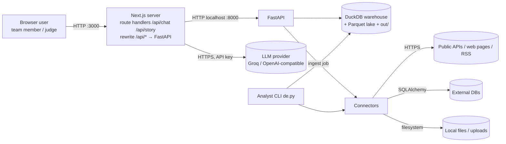

# Threat model (STRIDE) — VietLeap Insight Kit

Version 1.0 · 2026-11-15 · Method: STRIDE per element over the data-flow diagram below. Status column is **verified against
code** (file references) and updated in the same commit as each fix. Tasks: `specs/001-vietleap-insight-kit/tasks.md` T060–T067.

## 1. System & trust boundaries

Trust boundaries: (1) browser ↔ Next server, (2) Next ↔ LLM provider (third party), (3) API ↔ external sources (untrusted
content), (4) API ↔ filesystem/warehouse. The CLI is run by a trusted analyst on their own machine; the HTTP API may be exposed to
other people on the same network during the contest (e.g. judges' laptops), so it is treated as untrusted input.

Assets: dataset contents (may contain personal data), LLM API keys, the analyst's filesystem, integrity of numbers shown to judges,
availability of the demo during the 7-minute pitch.

## 2. STRIDE analysis

| # | STRIDE | Threat | Element | Control | Status |
|---|---|---|---|---|---|
| S1 | Spoofing | Anyone on the LAN calls the API | FastAPI | Bind to 127.0.0.1 (`Makefile api`), no auth by design (local tool); docker-compose must not publish API publicly | ✅ local bind · ⚠ no auth (accepted, non-goal) |
| T1 | Tampering | SQL endpoint used to modify/drop warehouse | `/api/sql`, AI `runSql` | single statement, start allowlist (SELECT/WITH/DESCRIBE/SHOW/SUMMARIZE/EXPLAIN/PRAGMA table_info), DDL/DML denylist, wrapped in `SELECT * FROM (…) LIMIT n` (`warehouse.py Warehouse.sql`) | ✅ done (test: `test_de_pipeline.py` 403) |
| I1 | Info disclosure | SQL reads local files via table functions / string table refs (`sniff_csv('/etc/…')`, `FROM 'x.csv'`, `parquet_scan`) | `/api/sql` | `/api/sql` uses `Warehouse.readonly()` (DuckDB `read_only`, `enable_external_access=false`, `lock_configuration`); denylist `_FILE_ACCESS` (sniff_csv, parquet_*, *_scan, query(), current_setting(), string/quoted-path table refs) in `Warehouse.sql` | ✅ done (T061, `tests/test_security.py`) |
| D1 | DoS | Expensive SQL (cross joins) hangs the single-writer DB | `/api/sql` | row limit ≤ 5000 (pydantic), AI limit 200; `con.interrupt()` after 20 s → HTTP 408 | ✅ done (T061) |
| I2 | Info disclosure / SSRF | `api`/`scrape`/`social` source URL points to localhost, 169.254.169.254, LAN admin pages; redirects to them | `/api/ingest` → connectors | `netguard.guard_source` (http/https only, no URL credentials, IP literal + all DNS answers must be public), httpx `event_hooks` re-check every request incl. redirects, social feeds fetched via the hooked client, `render_js` refused, `auth_env` only `KIT_TOKEN_*` (prevents exfiltrating the LLM key as Bearer) | ✅ done (T062) |
| I3 | Info disclosure | `file`/`cv` source uri = any local path (`/home/u/.ssh/…`, `.env`) then read back via SQL | `/api/ingest` | `netguard.check_path`: resolved path (symlinks followed) must be under data/, scenarios/, upload dir, out dir (+ `KIT_ALLOWED_DIRS`); cv options allowlist (no `--out`/`--video` override); zip-bomb limit | ✅ done (T063) |
| I4 | SSRF / lateral | `sql` source with SQLAlchemy URL to internal DB / arbitrary sqlite file | `/api/ingest` | SELECT-only query check, credentials masked in provenance; sqlite path confined; network DB host must be public (`KIT_ALLOW_PRIVATE_NET=1` for a trusted LAN demo) | ✅ done (T063) |
| T2 | Tampering / path traversal | upload filename `../../x`; dataset ids in paths | `POST /api/datasets`, `/datasets/{id}/…` | filename → slug, extension allowlist; ds id regex `^[a-z0-9_\-]{1,80}$` (`store.py`); export kind allowlist; chart name regex; `slugify` for DE routes | ✅ done |
| D2 | DoS | huge upload exhausts RAM | `POST /api/datasets` | 200 MB cap + extension allowlist, **but whole body read before check** | ⚠ partial → T064 |
| E1 | Elevation | prompt injection in dataset cells / scraped pages / RSS makes the LLM call tools or lie | `/api/chat`, `/api/story`, agent | all tools read-only (no write tools); SQL guarded; numbers verified (story/agent); `stopWhen` 8 steps; system prompts (`web/src/lib/analyst/prompt.ts` rule 6, `api/agent/runner.py` rule 6) say tool output/data is never instructions | ✅ done (T061) |
| I5 | Info disclosure | dataset rows sent to third-party LLM | `/api/chat` | tools return aggregates by default; `runSql` can return ≤ 200 rows; offline mode keeps everything local; documented in SECURITY.md (PII section) | ⚠ documented, user choice |
| I6 | Info disclosure | secrets committed | repo | `web/.gitignore` has `.env*` (!.env.example); root `.gitignore` only `.env`; keys only via env (`auth_env` for API connectors) | ⚠ partial → T067 (root `.env*`, gitleaks in CI) |
| S2 | Spoofing (CSRF-like) | another site's page in the user's browser POSTs to localhost API | FastAPI | CORS origin allowlist (`CORS_ORIGINS`), but `allow_methods=["*"]`, `allow_headers=["*"]`; JSON bodies need preflight | ⚠ partial → T064 |
| T3 | Tampering (clickjacking/XSS) | dashboard framed or injected script | Next.js | React escaping; story popovers HTML-escaped (`story.ts`); mermaid `securityLevel` default strict; **no CSP / X-Frame-Options / nosniff headers** | ❌ gap → T065 |
| D3 | DoS | request flood on SQL/ingest/LLM (quota burn) | API, `/api/chat` | none | ❌ gap → T066 |
| R1 | Repudiation | who ran which ingest/what changed | meta | `meta.runs` (run_id, step, status, timings, detail), `meta.lineage`, provenance with fetched_at | ✅ done |
| I7 | Info disclosure | stack traces / exception text to clients | API | global handler returns `"{type}: {msg}"` (no traceback) | ⚠ accepted (local tool; helps debugging) |
| T4 | Supply chain | vulnerable / malicious dependency | deps | lockfile (`web/package-lock.json`), pinned majors; **no audit** | ❌ gap → T067 (pip-audit, npm audit in CI) |
| L1 | Licence | non-open or copyleft component/data in submission | repo | `docs/licenses.md`, provenance `license_note`; ultralytics AGPL optional | ✅ done |

## 3. PII handling
- Datasets stay on the local machine (DuckDB file, Parquet, `out/`); nothing is uploaded anywhere except (a) LLM prompts when a key is
  configured and (b) requests to sources the analyst configured.
- CV counting stores counts only — no frames, faces or plates (`scenarios/cv_counting/count.py`).
- Recommendation: drop direct identifiers (names, phone numbers, CCCD/ID numbers, emails) before ingesting; use offline AI mode for
  sensitive datasets; delete `data/` and `out/` after the contest (`make clean-out`).

## 4. Residual risks (accepted)
No authentication/authorisation (local single-team tool); exception messages returned to clients; LLM output can still be wrong in
wording (numbers are verified, reasoning is not).
