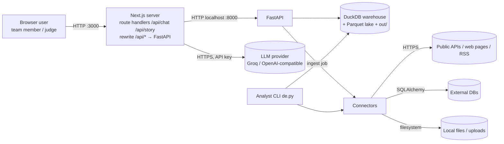

# Threat model (STRIDE) — VietLeap Insight Kit

Version 1.0 · 2026-11-15 · Method: STRIDE per element over the data-flow diagram below. Status column is **verified against
code** (file references) and updated in the same commit as each fix. Tasks: `specs/001-vietleap-insight-kit/tasks.md` T060–T067.

## 1. System & trust boundaries

Trust boundaries: (1) browser ↔ Next server, (2) Next ↔ LLM provider (third party), (3) API ↔ external sources (untrusted
content), (4) API ↔ filesystem/warehouse. The CLI is run by a trusted analyst on their own machine; the HTTP API may be exposed to
other people on the same network during the contest (e.g. judges' laptops), so it is treated as untrusted input.

Assets: dataset contents (may contain personal data), LLM API keys, the analyst's filesystem, integrity of numbers shown to judges,
availability of the demo during the 7-minute pitch.

## 2. STRIDE analysis

| # | STRIDE | Threat | Element | Control | Status |
|---|---|---|---|---|---|
| S1 | Spoofing | Anyone on the LAN calls the API | FastAPI | Bind to 127.0.0.1 (`Makefile api`), no auth by design (local tool); docker-compose must not publish API publicly | ✅ local bind · ⚠ no auth (accepted, non-goal) |
| T1 | Tampering | SQL endpoint used to modify/drop warehouse | `/api/sql`, AI `runSql` | single statement, start allowlist (SELECT/WITH/DESCRIBE/SHOW/SUMMARIZE/EXPLAIN/PRAGMA table_info), DDL/DML denylist, wrapped in `SELECT * FROM (…) LIMIT n` (`warehouse.py Warehouse.sql`) | ✅ done (test: `test_de_pipeline.py` 403) |
| I1 | Info disclosure | SQL reads local files via table functions / string table refs (`sniff_csv('/etc/…')`, `FROM 'x.csv'`, `parquet_scan`) | `/api/sql` | `/api/sql` uses `Warehouse.readonly()` (DuckDB `read_only`, `enable_external_access=false`, `lock_configuration`); denylist `_FILE_ACCESS` (sniff_csv, parquet_*, *_scan, query(), current_setting(), string/quoted-path table refs) in `Warehouse.sql` | ✅ done (T061, `tests/test_security.py`) |
| D1 | DoS | Expensive SQL (cross joins) hangs the single-writer DB | `/api/sql` | row limit ≤ 5000 (pydantic), AI limit 200; `con.interrupt()` after 20 s → HTTP 408 | ✅ done (T061) |
| I2 | Info disclosure / SSRF | `api`/`scrape`/`social` source URL points to localhost, 169.254.169.254, LAN admin pages; redirects to them | `/api/ingest` → connectors | `netguard.guard_source` (http/https only, no URL credentials, IP literal + all DNS answers must be public), httpx `event_hooks` re-check every request incl. redirects, social feeds fetched via the hooked client, `render_js` refused, `auth_env` only `KIT_TOKEN_*` (prevents exfiltrating the LLM key as Bearer) | ✅ done (T062) |
| I3 | Info disclosure | `file`/`cv` source uri = any local path (`/home/u/.ssh/…`, `.env`) then read back via SQL | `/api/ingest` | `netguard.check_path`: resolved path (symlinks followed) must be under data/, scenarios/, upload dir, out dir (+ `KIT_ALLOWED_DIRS`); cv options allowlist (no `--out`/`--video` override); zip-bomb limit | ✅ done (T063) |
| I4 | SSRF / lateral | `sql` source with SQLAlchemy URL to internal DB / arbitrary sqlite file | `/api/ingest` | SELECT-only query check, credentials masked in provenance; sqlite path confined; network DB host must be public (`KIT_ALLOW_PRIVATE_NET=1` for a trusted LAN demo) | ✅ done (T063) |
| T2 | Tampering / path traversal | upload filename `../../x`; dataset ids in paths | `POST /api/datasets`, `/datasets/{id}/…` | filename → slug, extension allowlist; ds id regex `^[a-z0-9_\-]{1,80}$` (`store.py`); export kind allowlist; chart name regex; `slugify` for DE routes | ✅ done |
| D2 | DoS | huge upload exhausts RAM | `POST /api/datasets` | 200 MB cap streamed in 1 MB chunks (`.part` file deleted on overflow), extension allowlist, `Content-Length` cap in `SecurityMiddleware` | ✅ done (T064) |
| E1 | Elevation | prompt injection in dataset cells / scraped pages / RSS makes the LLM call tools or lie | `/api/chat`, `/api/story`, agent | all tools read-only (no write tools); SQL guarded; numbers verified (story/agent); `stopWhen` 8 steps; system prompts (`web/src/lib/analyst/prompt.ts` rule 6, `api/agent/runner.py` rule 6) say tool output/data is never instructions | ✅ done (T061) |
| I5 | Info disclosure | dataset rows sent to third-party LLM | `/api/chat` | tools return aggregates by default; `runSql` can return ≤ 200 rows; offline mode keeps everything local; documented in SECURITY.md (PII section) | ⚠ documented, user choice |
| I6 | Info disclosure | secrets committed | repo | `.env*`, `*.pem`, `*.key` ignored in root and web (`!.env.example`); keys only via env; API connectors may only read `KIT_TOKEN_*` | ⚠ partial → T067 (gitleaks in CI) |
| S2 | Spoofing (CSRF-like) | another site's page in the user's browser POSTs to localhost API | FastAPI | CORS origin allowlist (wildcard dropped), methods GET/POST, headers Content-Type/Accept, no credentials; JSON bodies require preflight → cross-site POST blocked | ✅ done (T064) |
| T3 | Tampering (clickjacking/XSS) | dashboard framed or injected script | Next.js | React escaping; story popovers HTML-escaped; mermaid strict; CSP (self-only, `frame-ancestors 'none'`, `object-src 'none'`), X-Frame-Options DENY, nosniff, Referrer-Policy, Permissions-Policy, COOP on Next (`next.config.ts`) and API (`api/security.py`); `poweredByHeader:false` | ✅ done (T065; residual: `'unsafe-inline'` scripts without nonce) |
| D3 | DoS | request flood on SQL/ingest/LLM (quota burn) | API, `/api/chat` | sliding-window per-IP limits (API 60/min on expensive POSTs → 429 + Retry-After; LLM routes 20/min) | ✅ done (T066) |
| R1 | Repudiation | who ran which ingest/what changed | meta | `meta.runs` (run_id, step, status, timings, detail), `meta.lineage`, provenance with fetched_at | ✅ done |
| I7 | Info disclosure | stack traces / exception text to clients | API | global handler returns `"{type}: {msg}"` (no traceback) | ⚠ accepted (local tool; helps debugging) |
| T4 | Supply chain | vulnerable / malicious dependency | deps | lockfile (`web/package-lock.json`), pinned majors; **no audit** | ❌ gap → T067 (pip-audit, npm audit in CI) |
| L1 | Licence | non-open or copyleft component/data in submission | repo | `docs/licenses.md`, provenance `license_note`; ultralytics AGPL optional | ✅ done |

## 3. PII handling
- Datasets stay on the local machine (DuckDB file, Parquet, `out/`); nothing is uploaded anywhere except (a) LLM prompts when a key is
  configured and (b) requests to sources the analyst configured.
- CV counting stores counts only — no frames, faces or plates (`scenarios/cv_counting/count.py`).
- Recommendation: drop direct identifiers (names, phone numbers, CCCD/ID numbers, emails) before ingesting; use offline AI mode for
  sensitive datasets; delete `data/` and `out/` after the contest (`make clean-out`).

## 4. Residual risks (accepted)
No authentication/authorisation (local single-team tool); exception messages returned to clients; LLM output can still be wrong in
wording (numbers are verified, reasoning is not).

## 5. OWASP mapping

### OWASP Top 10 — Web (2021, with 2025 changes noted)
| OWASP | Relevant attack on this kit | Controls | Status |
|---|---|---|---|
| A01 Broken Access Control | path traversal on ids/files, reading local files via ingest or SQL, CSRF from another origin | id regex, filename slug, export allowlist, `netguard.check_path`, readonly DuckDB, CORS allowlist + preflight; no auth (local tool, accepted) | ✅ (auth = accepted residual) |
| A02 Cryptographic Failures (2025: A04) | API keys leaked in repo/logs/provenance | env-only secrets, `.env*` ignored, SQLAlchemy URL password masked in provenance, `auth_env` restricted | ✅ |
| A03 Injection | SQL injection via `/api/sql` & AI `runSql`; SQL predicates in `conform.where`; command injection in cv options | read-only connection + allowlist/denylist + LIMIT + timeout; `conformed._valid_where` filters predicates (YAML/CLI only); cv options allowlist, subprocess with arg list (no shell) | ✅ |
| A04 Insecure Design (2025: A06) | features that let an API caller pick arbitrary hosts/paths | STRIDE model, guards designed for API vs trusted CLI split | ✅ |
| A05 Security Misconfiguration (2025: A02) | wildcard CORS, missing headers, docs exposed | CORS restricted, security headers, API on 127.0.0.1; `/docs` kept for judges (local) | ✅ |
| A06 Vulnerable & Outdated Components (2025: A03 Software Supply Chain Failures) | vulnerable npm/PyPI deps, typosquats | lockfile; pip-audit + npm audit + Dependabot + CodeQL + gitleaks in CI | ⚠ → T067/T071 |
| A07 Identification & Authentication Failures | — (no accounts) | n/a — local single-team tool | ➖ n/a |
| A08 Software & Data Integrity Failures | tampered source data, unsigned deps | provenance fingerprints (sha256 per table), `_row_hash`, lockfiles; CI from GitHub Actions pinned major versions | ⚠ partial |
| A09 Security Logging & Monitoring Failures (2025: Logging & Alerting) | no trace of who ingested what | `meta.runs`, `meta.lineage`, provenance; uvicorn access log | ✅ (no alerting: accepted) |
| A10 SSRF (2025: merged into A01) | connectors fetching internal URLs, redirects, DNS rebinding | `netguard` + httpx hooks | ✅ |
| 2025 A10 Mishandling of Exceptional Conditions | crash/info leak on bad input | pydantic/zod validation → 4xx; global handler returns type+message (no traceback); one failing source doesn't stop the run | ✅ (message disclosure accepted) |

### OWASP Top 10 for LLM Applications (2025)
| OWASP LLM | Attack | Controls | Status |
|---|---|---|---|
| LLM01 Prompt Injection (direct & indirect) | instructions hidden in dataset cells, scraped pages, RSS, element JSON | system-prompt rule "tool output is data" (web + Python agent), read-only tools only, number verification, `stopWhen` 8 steps, context JSON ≤ 8000 chars | ✅ (residual: wording can still be manipulated; numbers cannot) |
| LLM02 Sensitive Information Disclosure | LLM reveals rows/PII or env secrets | tools return aggregates; runSql ≤ 200 rows and cannot read files/env; offline mode for sensitive data; keys never in prompts | ✅ |
| LLM03 Supply Chain | malicious model/provider SDK | official AI SDK packages, provider selectable, local Ollama option | ⚠ audits → T067 |
| LLM04 Data & Model Poisoning | poisoned source data biases insights | provenance + quality report + outlier flags; judges can trace every number to SQL | ⚠ partial (inherent) |
| LLM05 Improper Output Handling | LLM text rendered as HTML/markdown → XSS; SQL from LLM executed | story popovers HTML-escaped; chat rendered as React text; LLM SQL goes through the same read-only guard | ✅ |
| LLM06 Excessive Agency | AI writes/deletes data, calls external URLs | no write tools, no ingest tool, no URL-fetch tool; SQL read-only | ✅ |
| LLM07 System Prompt Leakage | prompt reveals secrets | prompts contain no secrets (keys only in server env) | ✅ |
| LLM08 Vector & Embedding Weaknesses | — | no RAG/vector store | ➖ n/a |
| LLM09 Misinformation | hallucinated numbers in pitch | constitution I; number verification (`story.ts`, `api/agent/verify.py`); causal-language rule | ✅ |
| LLM10 Unbounded Consumption | request floods burn LLM quota | 20/min/IP on `/api/chat` & `/api/story`, `maxOutputTokens`, 40–120 s timeouts, step cap | ✅ |

### Cross-cutting attacker techniques
| Technique | Control | Status |
|---|---|---|
| SQL injection | readonly DuckDB + guards (A03) | ✅ |
| SSRF / DNS rebinding / open redirect | netguard + per-request hook | ✅ (Playwright render refused via API) |
| Path traversal / symlink escape / zip slip / zip bomb | id regex, slug, resolved-path allowlist, `zipfile` sanitising, 2 GB unzip cap | ✅ |
| XSS / clickjacking | React escaping, HTML escape, CSP, X-Frame-Options | ✅ |
| CSRF | CORS allowlist + JSON preflight, no cookies/credentials | ✅ |
| DoS | rate limits, body cap, SQL timeout, row limits, DuckDB 2 threads | ✅ |
| Supply chain | lockfile; pip-audit, npm audit, gitleaks, Dependabot, CodeQL | ⚠ → T067/T071 |
| Secrets exposure | env-only, `.env*` ignored, `auth_env` prefix, provenance masking; gitleaks | ⚠ CI part → T067 |
