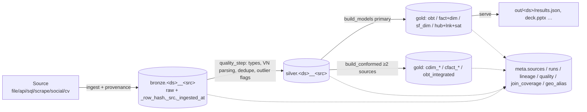

# Data Model

Normative JSON Schemas: [contracts/](contracts/) (`pipeline`, `lineage`, `conformed`, `brief`, `story`) and
[contracts/openapi.json](contracts/openapi.json) (all FastAPI endpoints). Contract tests: `tests/test_contracts.py`.

## 1. Medallion layers (DuckDB `data/warehouse.duckdb`, Parquet mirror `data/lake/<layer>/<table>.parquet`)



| Layer | Naming | Contents | Mutability |
|---|---|---|---|
| bronze | `bronze.<ds>__<source_or_sheet>` | as ingested, all columns text-safe, `_row_hash` (hash of source columns), `_src`, `_ingested_at` | replace / append / incremental (`--mode`) |
| silver | `silver.<ds>__<src>` | typed, VN-parsed (`<col>__province`, `<col>__district`, `_key` columns), exact duplicates removed, outliers (3×IQR) flagged in `_outlier_any` (never deleted), optional median impute | rebuilt from full bronze each run |
| gold | see §2 | analytical models | rebuilt each run |
| meta | `meta.*` | run log, lineage edges, quality reports, source provenance, join coverage, geo aliases, province reference | append (join_coverage replaced per dataset) |

## 2. Gold models (`engine/vlkit/de/modeling.py`, `conformed.py`)

| Model | Tables | Grain / keys | Use |
|---|---|---|---|
| **OBT** | `gold.obt_<ds>` | one row per silver row | insight engine, dashboard, ML |
| **Star** | `gold.fact_<ds>` (`fact_id`, `date_key`, `geo_key`, `<cat>_key`, measures) + `gold.<ds>__dim_date`, `__dim_geo` (district grain when available: district, district_norm, province, province_2025, region), `__dim_<cat>` | fact = silver row; dims = distinct values with surrogate keys | semantic model in pitch, BI |
| **Snowflake** | `gold.<ds>__sf_dim_province` → `sf_dim_province_2025`, `sf_dim_region` (+ date → month → year) | normalised hierarchy district → province → province_2025 → region | show normalisation trade-off |
| **Data Vault 2.0** | `gold.<ds>__hub_<key>` (`hk_<key>` = md5 business key, `load_dts`, `record_source`), `gold.lnk_<ds>`, `gold.sat_<ds>` (`hashdiff`) | hubs per business key, link per row combination, satellite descriptive attrs | auditability/history story |
| **Conformed** | `gold.<ds>__cdim_geo` (`geo_key`, district, district_norm, geo_level, province, province_key, province_2025, province_2025_key, region, in_reference), `__cdim_date` (`date_key` YYYYMMDD, year, quarter, month, month_key, weekday), `__cdim_year`, `__cdim_<key>` (ticker, country, custom), `__cfact_<src>` (silver + FKs + `_source_table`), `gold.obt_integrated_<ds>` | one shared dim per business key across sources; integrated OBT at primary grain, other sources LEFT JOINed only when unique at join grain (or `conform.agg`) | multi-source analysis, join coverage |

Province normalisation: 63 legacy provinces → 34 units (NQ 202/2025/QH15) via `engine/vlkit/resources/province_63_to_34.csv`;
6 GSO regions via `province_region.csv`.

## 3. Entities

| Entity | Fields | Defined in |
|---|---|---|
| Source | name `^[A-Za-z0-9_]+$`, kind ∈ {file, api, sql, scrape, social, cv}, uri, options, license_note, conform{where, agg, geo_level, province} | `de/sources.py`, `api/routes/pipeline.py SourceIn` |
| IngestResult | source, frames{name→DataFrame}, provenance | `de/sources.py` |
| Provenance | source, kind, uri (credentials masked), options, fetched_at, license_note, tables{rows, cols, fingerprint} | `make_provenance` |
| Run step (`meta.runs`) | run_id, dataset, step (`ingest:<src>`, `clean:<t>`, `conform`), status, started_at, finished_at, detail{mode, inserted, skipped, scores…} | `warehouse.log_run` |
| LoadStats | table, mode, inserted, skipped, rebuilt, rows, reason | `Warehouse.write_bronze` |
| QualityReport | before/after{rows, cols, missing_cells, invalid_cells, duplicate_rows, candidate_key, duplicate_keys, score, columns, issues[]}, cleaning_log[], score_before, score_after | `de/quality.py` |
| LineageEdge | from, to, step ∈ {ingest, clean, model, conform, fk, integrate, serve} | `de/lineage.py` |
| JoinCoverage | per source×key: matched/unmatched/null rows, match_pct; per join: status, matched rows, unmatched samples; overlap Jaccard | `de/conformed.py` |
| Insight | id, rank, kind, title_vi/en, sentence_vi/en, value, test, p_value, effect, evidence{n…}, chart spec, columns, caveat | `insights.py` |
| Recommendation | so_what_vi/en, now_what_vi/en, impact_vi/en, evidence (linked insight) | `decision.py` |
| DriverModel | target, n, features, leakage_excluded, log_target, cv_r2{ridge_mean/std, gb_mean/std}, importance[{feature, importance, std}] (permutation, gradient boosting), coefficients[{feature, coef_std, ci90, direction, stable}] (bootstrap ridge), whatif{target_mean, features[{name, mean, sd, beta, boot[]}]}, note | `models.py` |
| WhatIfResult | feature, pct_change, target, target_change_pct, ci90_pct[lo,hi], target_change_abs, baseline_target_mean, interpretation | `models.what_if` |
| Brief | see `contracts/brief.schema.json` | `brief.py` |
| ScenarioPack | id, title, sponsor, domain, keywords, expected_columns, kpis, recipe, decision_template, deck_storyline | `scenarios/packs/*.yaml` |
| Story / StoryStep | mode, model, headline, steps[{id, rank, title, narration, stats, action, source}], closing | `web/src/lib/analyst/story.ts` |

## Output files (out/&lt;ds&gt;/) — summarised; normative schemas in [contracts/](contracts/)

### `pipeline.json`
```jsonc
{ "dataset": "demo_multi", "run_id": "a1b2c3d4", "finished_at": "2026-11-14T10:00:00+07:00",
  "timings": {"ingest": 1.2, "clean": 0.8, "model": 0.5, "conform": 0.3, "serve": 4.1},
  "steps": [{"step": "ingest:<src>", "status": "ok|failed", "tables": ["..."], "error": "..."}],
  "bronze": ["bronze.<ds>__<src>"], "silver": ["silver.<ds>__<src>"], "primary": "silver.<ds>__<src>",
  "gold": ["gold.obt_<ds>", "..."],
  "quality": {"silver.<t>": {"score_before": 84.9, "score_after": 92.4, "rows": 81681, "issues": 7}},
  "models": {"obt|star|snowflake|data_vault|conformed": {"tables": ["gold.*"], "erd": "erDiagram ..."}},
  "column_plan": {...}, "rationale": {...}, "recommended": "...",
  "provenance": [{"source": "...", "kind": "...", "uri": "...", "fetched_at": "...", "license_note": "...", "tables": {...}}],
  "conformed": null | <conformed.json>,
  "load": {"mode": "replace|append|incremental", "tables": {"bronze.<t>": {"inserted": 0, "skipped": 0, "rebuilt": false}}},
  "served": true }
```

### `quality.json`
`{ "silver.<t>": { "before": {rows, cols, missing_cells, invalid_cells, duplicate_rows, candidate_key, duplicate_keys, score, columns, issues[]}, "after": {...}, "cleaning_log": [...], "score_before": n, "score_after": n } }`

### `lineage.json`
`{ "dataset", "nodes": [{id, label, layer: source|bronze|silver|gold|serving, stage: Ingestion|Storage|Transform|Serving}], "edges": [{from, to, step}], "join_coverage"?: {joins, sources} }`

### `conformed.json`
```jsonc
{ "shared_keys": ["geo", "year"], "dims": {"geo": "gold.<ds>__cdim_geo", "year": "gold.<ds>__cdim_year"},
  "facts": {"silver.<t>": "gold.<ds>__cfact_<src>"}, "integrated": "gold.obt_integrated_<ds>",
  "integrated_rows": 1234, "base": ["silver.<t>"], "base_rows": 1234, "row_explosion": false,
  "joins": [{"source": "...", "keys": ["year"], "join_on": ["year_key"], "status": "joined|skipped_not_unique|...",
             "aggregated": null, "where": null, "columns_added": 3, "distinct_keys": 20,
             "matched_rows": 1000, "unmatched_rows": 234, "match_pct": 81.0, "unmatched_samples": ["..."], "source_keys_used": 18}],
  "sources": [{"table": "...", "source": "...", "rows": 100, "geo_level": "district|63|2025|null",
               "keys": {"geo": {"column": "...", "matched_rows": 98, "null_key_rows": 1, "unmatched_rows": 1, "match_pct": 98.0, "outside_reference_rows": 0}}}],
  "overlap": [{"key": "year", "a": "...", "b": "...", "a_keys": 20, "b_keys": 30, "shared_keys": 15, "jaccard": 0.43}],
  "detected": {"silver.<t>": {"geo": "<col>", "year": "<col>"}} }
```

### `brief.json`
`{ language: "vi"|"en", title, questions[], target: {concept, label, column, resolved, domain, score}|null, alternatives[], units[], segments[], time: {years[], range}, decision_types: [{id, label, hits}], deliverables[], data_sources_mentioned[], pack: {id, title, sponsor, kpis, recipe, decision_template, deck_storyline, expected_columns}|null, pack_scores, run_config: {target, domain, segment_by}, plan[], warnings[], dataset }`

Khác: `results.json` (insight engine: meta, profile, insights, drivers, timeseries, segments, recommendations, kpis), `whatif.json`, `provenance.json`, `models/*.sql|*.mmd`.

