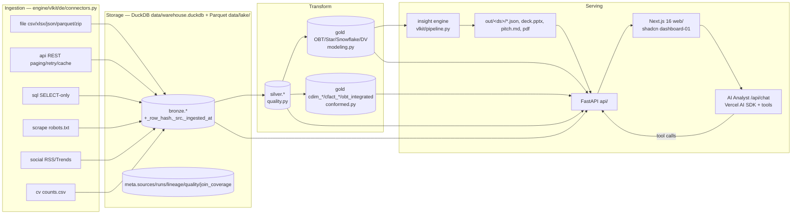

# Implementation Plan: VietLeap Insight Kit

**Spec**: [spec.md](spec.md) · **Date**: 2026-11-15 · **Status**: core implemented, wow features in progress ([tasks.md](tasks.md))

## Summary
Một repo duy nhất gồm engine Python (DE + insight), FastAPI, và dashboard Next.js/shadcn. Dữ liệu đi Ingestion → DuckDB
bronze/silver/gold → mô hình (OBT/Star/Snowflake/Data Vault/Conformed) → insight engine → JSON/PPTX/PDF → API → web + AI Analyst.

## Technical Context
**Language/Version**: Python ≥ 3.11 (dev: 3.12); TypeScript 5, Node ≥ 20 · **Web**: Next.js 16.4 (App Router, Turbopack), React 19.3, Tailwind 4, shadcn/ui (base-nova, dashboard-01), Recharts 3, mermaid 12, driver.js 1.12, Vercel AI SDK 7 (`ai`, `@ai-sdk/groq`, `@ai-sdk/openai-compatible`), zod 4
**Primary Dependencies (Python)**: pandas 3, duckdb 2.0, scipy, statsmodels, scikit-learn, httpx + tenacity, SQLAlchemy, selectolax/lxml, feedparser, python-pptx, plotly/kaleido, FastAPI + pydantic 2, PyYAML; optional: playwright, pytrends, ultralytics + supervision
**Storage**: DuckDB file `data/warehouse.duckdb` + Parquet lake `data/lake/`; outputs `out/<ds>/`
**Testing**: pytest (`tests/`), node `--test` (`web/src/**/*.test.ts`), eslint, `next build`; JSON-Schema contract tests
**Target Platform**: Linux/macOS laptop (Windows via WSL2), 2 CPU / 7 GB RAM, no GPU
**Project Type**: web application (backend `api/` + `engine/`, frontend `web/`)
**Performance Goals**: NFR-001..002 (100k rows ≤ 60 s DE; ≤ 4 GB RSS)
**Constraints**: offline-capable; no build concurrently with pytest; `NO_PROXY=localhost,127.0.0.1` behind proxies
**Scale/Scope**: 1 team, ≤ 20 sources per run, datasets ≤ ~1M rows, ~15 pages

## Reuse vs Build (summary — full table in [research.md §R13](research.md#r13-reuse-vs-build--capability-map))
| Capability | Reused (integrated) | Built (why) | Recommended next |
|---|---|---|---|
| Ingestion | DuckDB/pandas readers, httpx+tenacity, SQLAlchemy, selectolax, feedparser, Playwright | thin connector layer + provenance (one contract for 6 source kinds) | dlt for many paginated APIs; trafilatura for news text |
| Storage | DuckDB + Parquet | — | — |
| Transform/models | DuckDB SQL engine | model generator (runtime column roles → OBT/Star/Snowflake/DV/conformed) | export generated SQL as dbt-duckdb project post-contest |
| Quality | pandas | VN parsing + before/after score | pandera schemas in tests |
| Stats/ML | scipy, statsmodels, scikit-learn | insight ranking + VI/EN sentences | — |
| UI | shadcn dashboard-01, Recharts, mermaid, driver.js | page composition only | shadcn Command (Ctrl+K), Slider, d3-geo map |
| AI | Vercel AI SDK, Groq/OpenAI-compatible | number-verification guard | — |
| Reports | python-pptx, Marp, Chromium | text fitting / overflow check | — |
| CV | ultralytics, supervision | CSV contract | — |

## Constitution Check
| Principle | Gate | Status |
|---|---|---|
| I Real numbers only | UI/deck/AI numbers from engine/DuckDB; story/agent number verification | ✅ pass (`story.ts`, `api/agent/verify.py`, tests) |
| II Stat-tested insights | test, p, effect, n on every insight | ✅ pass (`insights.py`, `stats.py`) |
| III No causal claims | prompts + what-if interpretation text + deck Limitations slide | ✅ pass |
| IV Reuse OSS UI as-is | only `components/ui/*` from shadcn CLI; dashboard-01 untouched theme | ✅ pass (re-check on every new page) |
| V Open-source only | deps OSS; licences recorded | ✅ pass (`docs/licenses.md`) |
| VI Security by default | read-only SQL, input validation, SSRF/path guards, headers | ⚠ partial — see `docs/security/threat-model.md` gap list (T060–T068) |
| VII Offline-first | offline AI paths, API cache | ✅ pass |
| VIII Tests before push | pytest + web test/lint/build before each push | ✅ process (CI planned T070) |

## Kiến trúc



Thành phần:

| Thư mục | Vai trò | Entry |
|---|---|---|
| `engine/vlkit/` | Engine Python (pandas, scipy, statsmodels/sklearn, duckdb, python-pptx, plotly) | `run.py` (insight 1 file), `de.py` (pipeline DE) |
| `engine/vlkit/de/` | Lớp Data Engineering: connectors, warehouse, quality, modeling, conformed, lineage, flow | `flow.run_flow`, `flow.run_file` |
| `api/` | FastAPI: dataset lifecycle, analysis, DE/pipeline, brief, agent SSE | `uvicorn api.main:app --port 8000` |
| `web/` | Next.js 16 App Router + shadcn/ui + Recharts + mermaid + driver.js + AI SDK v7 | `npm run dev` / `build`+`start` |
| `scenarios/` | `packs/` (7 miền đề), `briefs/` (đề mẫu), `demo/` (5 loại nguồn), `conformed/`, `cv_counting/` | |
| `slides/` | `pitch.md` storyline Marp 7 phút | |
| `tests/` | pytest (engine, DE, deck, CV, brief, VN parsing); `web/src/**/*.test.ts` (node --test) | |


## Project Structure
```
.specify/memory/constitution.md     principles (gates for every change)
specs/001-vietleap-insight-kit/     spec, plan, research, data-model, contracts/, quickstart, tasks, checklists/
docs/                               SRS.md, SPEC.md (index), MASTER_PLAN.md, PLAYBOOK.md, CONTEXT.md, security/, licenses.md
engine/vlkit/                       insight engine: loader, vn, profile, stats, insights, models, decision, domains, brief, report, tools, pipeline
engine/vlkit/de/                    sources, connectors, warehouse, quality, modeling, conformed, lineage, flow
engine/vlkit/resources/             province reference tables (63→34, regions)
api/                                main.py, settings.py, store.py, jobs.py, schemas.py, routes/ (datasets, analysis, pipeline, brief, agent), agent/ (runner, llm, verify)
web/src/app/(dashboard)/            pages; web/src/app/api/{chat,story} route handlers
web/src/components/                 dashboard-01 blocks + ui/ (shadcn) + inspector/sheet/charts
web/src/lib/                        api client & types, analyst (tools, model, prompt, explain, story), tour-steps
scenarios/                          packs/, briefs/, demo/, conformed/, cv_counting/
tests/  tools/  slides/  data/practice/
```

## Module

### Ingestion — `engine/vlkit/de/connectors.py`, `sources.py`
`Source(name, kind, uri, options, license_note, conform)`; `KINDS = file, api, sql, scrape, social, cv`. Mỗi lần ingest trả `IngestResult(frames, provenance)` — một nguồn có thể sinh nhiều bảng (sheet Excel, bảng HTML).

| kind | Hành vi |
|---|---|
| `file` | csv (tự dò encoding/dấu phân cách), xlsx (mọi sheet), json, parquet, zip (mọi file bên trong) |
| `api` | httpx GET, `params`, `records_path` (đào vào JSON), `paging` (`worldbank`, page/offset), retry (tenacity) cho lỗi mạng/5xx/429, `min_interval` rate-limit, cache JSON trong `data/cache/` |
| `sql` | SQLAlchemy URI, chỉ chấp nhận `SELECT` |
| `scrape` | kiểm `robots.txt` trước, delay, đọc bảng HTML (`table_index: largest|n`), tuỳ chọn render Playwright; không vượt captcha/đăng nhập |
| `social` | RSS (feedparser), Google Trends (pytrends nếu cài) |
| `cv` | `counts.csv` hoặc log sự kiện vượt vạch từ `scenarios/cv_counting/count.py` |

Provenance mỗi nguồn: `source, kind, uri, options, fetched_at, license_note, tables{rows, cols, fingerprint(sha256)}`.
`sources.yaml`: `dataset`, `keys:` (khoá conformed khai báo), `sources: [{name, kind, uri, options, license, conform}]` (đường dẫn file tương đối theo yaml).

### Storage — `engine/vlkit/de/warehouse.py`
DuckDB file `data/warehouse.duckdb`, 4 schema: `bronze` (nguyên trạng + `_row_hash`, `_src`, `_ingested_at`), `silver`, `gold`, `meta`.
Mỗi bảng bronze/silver/gold có bản Parquet `data/lake/<layer>/<name>.parquet`. Bảng meta: `sources`, `runs(run_id, dataset, step, status, started_at, finished_at, detail JSON)`, `lineage`, `quality`, `join_coverage`, `geo_alias`, bảng tham chiếu tỉnh.
`Warehouse.sql()` chỉ đọc: một câu `SELECT/WITH/DESCRIBE/SHOW/SUMMARIZE/EXPLAIN`, chặn DDL/DML/`read_*()`/`glob()`/`COPY`/`ATTACH`…, bọc `LIMIT`.
Chế độ nạp (`mode`): xem mục con dưới.

#### Nạp tăng dần (incremental) — đã triển khai (T040)
`--mode replace|append|incremental` (mặc định `replace`). `append`: thêm mọi dòng mới vào bronze; `incremental`: chỉ thêm dòng có `_row_hash` chưa có; schema đổi (khác tập cột) → tự rebuild toàn bộ bảng (`replace`). Số dòng `inserted/skipped` ghi vào `meta.runs.detail` và `pipeline.json.load`.

### Transform 1 — chất lượng → silver (`engine/vlkit/de/quality.py`, `vn.py`, `loader.py`)
- Phân tích kiểu & vai trò cột (số, phân loại, thời gian, địa lý, id, text) có xử lý định dạng Việt: số `1.234,5`, "2,5 tỷ", "800 triệu", ngày `dd/mm/yyyy`, tên tỉnh có/không dấu, "TP. HCM", quận/huyện (`normalize_district`).
- Đo trước/sau: missing, ô không hợp lệ, dòng trùng, khoá ứng viên & trùng khoá, outlier 3×IQR (**gắn cờ**, không xoá) → điểm 0–100 (`score_before/after`).
- Cleaning log từng bước; `--impute median` tuỳ chọn. Chuẩn hoá tỉnh 63 → 34 (NQ 202/2025/QH15), vùng GSO.

### Transform 2 — mô hình dữ liệu (`engine/vlkit/de/modeling.py`)
Trên bảng silver chính (lớn nhất hoặc `--primary`):
- **OBT** `gold.obt_<ds>` — bảng phẳng cho insight engine/BI.
- **Star** `fact_<ds>` + `dim_*` (dim_geo cấp quận/huyện khi có, dim_date, dim phân loại).
- **Snowflake** dim chuẩn hoá: district → province → province_2025 → region.
- **Data Vault 2.0** `hub_*`, `lnk_*`, `sat_*` (hash key, load_date, record_source).
- Sinh ERD Mermaid + SQL (`out/<ds>/models/*.sql|*.mmd`), `rationale` và `recommended` (vì sao chọn mô hình nào).

### Transform 3 — conformed dimensions (`engine/vlkit/de/conformed.py`)
Khi ≥2 bảng silver chung khoá (khai báo trong `keys:` hoặc tự phát hiện: tỉnh, quận/huyện, năm, ngày, mã CK, quốc gia ISO3, khoá bất kỳ):
`gold.<ds>__cdim_geo|cdim_date|cdim_year|cdim_<key>`, `gold.<ds>__cfact_<src>` (mọi dòng + FK), `gold.obt_integrated_<ds>` (LEFT JOIN chỉ khi nguồn kia unique tại grain join, hoặc YAML `conform.agg`; không bao giờ nhân dòng).
Tuỳ chọn mỗi nguồn: `conform: {where, agg: mean|sum|min|max|first, geo_level: "2025", province}`.
Join coverage: matched/unmatched/null mỗi nguồn × khoá, mẫu chưa khớp, overlap Jaccard từng cặp → `meta.join_coverage`, `pipeline.json.conformed`, `conformed.json`, `lineage.json.join_coverage`.

### Lineage — `engine/vlkit/de/lineage.py`
`meta.lineage(from_node, to_node, step)` với step `ingest, clean, model, conform, fk, integrate, serve` → `lineage.json {dataset, nodes[{id,label,layer,stage}], edges[{from,to,step}], join_coverage?}` + `lineage.mmd` (subgraph Ingestion/Storage/Transform/Serving).

### Insight engine — `engine/vlkit/pipeline.py`, `insights.py`, `stats.py`, `models.py`, `decision.py`, `domains.py`
`run(path, target, time_col, geo_col, domain)` → `out/<ds>/results.json`:
- Hồ sơ dữ liệu (`profile.py`), chọn target/time/geo theo domain (`property`, `public_finance`, `firm`, `generic`; chỉ số dẫn xuất như `price_per_m2`, `roe_pct`).
- Insight xếp hạng (≤12): phân khúc (Kruskal–Wallis + ANOVA, top-vs-bottom Mann–Whitney/Welch t, ε², η², rank-biserial, Cohen d), xu hướng (hồi quy tuyến tính `linregress`, phát hiện điểm gãy hai đoạn, `trend_stats`), tập trung (top-20% share, Gini, HHI), tương quan (Spearman, p hiệu chỉnh Bonferroni), drivers, cụm (KMeans `segment`). Mỗi insight có `test, p_value, effect, evidence, chart, caveat`, câu VI/EN.
- `stat_test`: `auto, mannwhitney, ttest, kruskal, anova, spearman, pearson, chi2`.
- Dự báo (`forecast`, horizon 3): Holt (ExponentialSmoothing trend cộng, statsmodels) so với hồi quy tuyến tính trên tập giữ lại, chọn mô hình tốt hơn.
- **Drivers** (`models.fit_drivers`): Ridge chuẩn hoá (log target khi lệch) + bootstrap CI90 hệ số, Gradient Boosting + permutation importance, lọc rò rỉ (|r|>0.97), R² kiểm định chéo cả hai.
- **What-if** (`models.what_if`): đổi biến số x% → % thay đổi target + khoảng 90% bootstrap; `GET whatif/curve` −30…+30%.
- **Khuyến nghị** (`decision.recommend`): so-what, now-what, impact (VI/EN) gắn insight bằng chứng.

### Brief parser — `engine/vlkit/brief.py`
Rule-based VI/EN (không cần LLM): tách câu hỏi, chấm điểm concept → biến mục tiêu (khớp cột thật nếu có dataset), đơn vị (tỉnh/quận/doanh nghiệp/…), phân khúc, mốc năm, loại quyết định, deliverables, nguồn được nhắc, scenario pack phù hợp nhất, `run_config`, `plan`, `warnings`.

### Scenario packs — `scenarios/packs/*.yaml`
7 pack: `cv_observation`, `data_economy_property`, `development_indicators`, `economic_policy`, `listed_firms_market`, `public_finance_province`, `social_impact`. Trường: `id, title, sponsor, domain, keywords, expected_columns, kpis, recipe, decision_template, deck_storyline`. Đề mẫu trong `scenarios/briefs/`.

### Báo cáo — `engine/vlkit/report.py`
`deck.pptx` 15 slide (bìa, KPI, insight + biểu đồ Plotly→PNG, drivers, what-if, Data pipeline, Data model, Data quality trước/sau, Policy recommendation, Limitations, Provenance); fit chữ (co ≥10pt rồi cắt) + `deck_overflow()`. `pitch.md` (Marp, số từ engine), `executive_summary.md/html/pdf` (PDF qua Chromium headless nếu có), `dashboard.html` tĩnh.

### CV counting — `scenarios/cv_counting/count.py`
YOLOv8n + ByteTrack (supervision / trackers / ultralytics) + `LineZone` → `counts.csv (timestamp,class,in,out)` zero-fill theo `--every`; `--events` gộp log vượt vạch không cần torch; exit 2 thân thiện khi thiếu thư viện; `meta.json` ghi giấy phép. Đầu ra đi qua connector `cv`.


## API (FastAPI, `api/`)

| Method | Path | Mô tả |
|---|---|---|
| GET | `/api/health` | trạng thái, số dataset |
| GET | `/api/datasets` | danh sách dataset (đọc `out/*/results.json`) |
| POST | `/api/datasets` | upload file (multipart: file, target, time, geo, domain, name) → job phân tích nền |
| GET | `/api/jobs/{id}` | trạng thái job upload |
| GET | `/api/datasets/{id}` · `/profile` · `/rows` | tóm tắt, hồ sơ cột, phân trang dòng |
| GET | `/api/datasets/{id}/files/{kind}` | export: `deck, dashboard, summary_pdf, summary_md, results, clean_csv` |
| GET | `/api/datasets/{id}/charts/{name}.png` | biểu đồ PNG |
| GET | `/api/datasets/{id}/insights` | insight + khuyến nghị |
| GET | `/api/datasets/{id}/timeseries` | chuỗi thời gian (metric, agg, freq, group) + trend/forecast |
| GET | `/api/datasets/{id}/segments` | nhóm theo cột + kiểm định + cụm |
| GET | `/api/datasets/{id}/drivers` | drivers + đặc trưng cho what-if |
| POST | `/api/datasets/{id}/whatif` | `{feature, pct_change, target?}` → % thay đổi + CI90 |
| GET | `/api/datasets/{id}/whatif/curve` | đường −30…+30% |
| GET | `/api/agent/config` · POST `/api/datasets/{id}/agent` | agent Python (SSE: plan/tool_call/…/verification) |
| GET | `/api/sources/kinds` | loại nguồn + ví dụ |
| POST | `/api/ingest` | `IngestIn {dataset, sources[], primary?, impute?, serve, mode?}` → job pipeline DE |
| GET | `/api/ingest/{job_id}` | trạng thái job DE |
| GET | `/api/warehouse/tables` · `/tables/{fq}/columns` | danh mục warehouse |
| POST | `/api/sql` | SQL chỉ đọc `{query, limit≤5000}` → `{columns, rows, row_count}`; 403 khi vi phạm |
| GET | `/api/datasets/{ds}/pipeline` · `/quality` · `/lineage` · `/models` · `/provenance` | đầu ra DE |
| GET | `/api/datasets/{ds}/conformed` | conformed.json (dims, facts, joins, coverage) + `erd` + `sql`; 404 khi < 2 nguồn chung khoá (T043) |
| POST | `/api/brief` · GET `/api/brief/packs` · `/api/brief/samples` | đề → brief.json |

Ghi DuckDB: một writer, mọi request warehouse đi qua `_wh_lock`.

## Web (Next.js 16, `web/`)
Mọi request `/api/*` không phải route Next được rewrite sang FastAPI (`next.config.ts`), không có CORS ở trình duyệt.
Trang (`web/src/app/(dashboard)/`): **Tổng quan** `/`, **Đề bài** `/brief`, **Nguồn dữ liệu** `/sources` (form nhiều nguồn → `/api/ingest`), **Pipeline** `/pipeline` (lineage mermaid, timings, steps), **Chất lượng** `/quality`, **Mô hình** `/model` (Tabs OBT/Star/Snowflake/Data Vault + ERD + SQL), **SQL Explorer** `/sql`, **Hồ sơ** `/profile`, **Insight** `/insights`, **Drivers & What-if** `/drivers`, **Phân khúc** `/segments`, **Quyết định** `/decision`, **AI Analyst** `/analyst`.
Route handler Next: `/api/chat` (AI SDK `streamText` + tools), `/api/story`.
Chọn dataset qua `DatasetProvider`; Exports trong sidebar (deck, dashboard HTML, PDF).

### Explain-anything & tour (`web/src/components/insight-inspector.tsx`, `insight-sheet.tsx`, `lib/tour-steps.ts`, `lib/analyst/explain.ts`)
- **Hướng dẫn**: tour driver.js theo trang (bước viết tay + tự phát hiện phần tử `data-insight-target`), một tour tại một thời điểm, huỷ khi đổi route, bỏ phần tử thiếu.
- **Hỏi AI**: bật ở thanh trên, rê/bấm phần tử có `data-insight-target` (+ `data-insight-*` payload) → Sheet AI giải thích (LLM, hoặc offline deterministic `explain.ts`); Esc thoát.
- **Câu chuyện**: `/api/story` kể top-5 insight (LLM hoặc text engine), giữ câu LLM chỉ khi mọi con số khớp output engine (`lib/analyst/story.ts`), driver.js lần lượt highlight từng thẻ insight.

### AI Analyst tools (`web/src/lib/analyst/tools.ts`)
`listTables, getColumns, runSql, getInsights, getSegments, getDrivers, whatIf, getQuality, getLineage, getModels` — đều gọi FastAPI; system prompt (`prompt.ts`) cấm tự tính số. Model: Groq (`GROQ_API_KEY`) ưu tiên, hoặc OpenAI-compatible; không có khoá → trả lời offline từ engine. Agent Python song song trong `api/agent/` (`runner.py` + `verify.py` kiểm số, một vòng tự sửa).


## CLI & Makefile
```
python de.py file <path> [--name DS] [--impute median] [--serve] [--target COL] [--out DIR] [--mode replace|append|incremental]
python de.py run <sources.yaml> [--primary SRC] [... như trên]
python de.py tables | sql "SELECT ..." [--limit N] | brief <đề.md> [--data file] [--out brief.json]
python run.py <file> [--target ...]          # insight engine trực tiếp
python scenarios/cv_counting/count.py --video v.mp4 | --events log.csv
make setup | api | web | web-dev | demo | demo-online | brief F=.. D=.. | test | test-py | test-web | clean-out
```

## Biến môi trường
| Biến | Nơi | Ý nghĩa |
|---|---|---|
| `KIT_OUT_DIR`, `KIT_UPLOAD_DIR` | api | thư mục out/ và upload |
| `CORS_ORIGINS` | api | mặc định localhost:3000 |
| `LLM_BASE_URL`, `LLM_MODEL`, `LLM_API_KEY`/`OPENAI_API_KEY`, `LLM_TIMEOUT_S`, `AGENT_MAX_STEPS` | api agent | agent Python OpenAI-compatible |
| `REPORTS_ON_UPLOAD` | api | sinh deck/PDF khi upload (mặc định 1) |
| `API_URL` | web (server) | FastAPI cho rewrite + tools (mặc định http://127.0.0.1:8000) |
| `NEXT_PUBLIC_API_URL`, `NEXT_PUBLIC_API_DOCS_URL` | web (client) | base URL tuỳ chọn, link tài liệu API |
| `GROQ_API_KEY`, `GROQ_MODEL` | web | LLM Groq (ưu tiên) |
| `OPENAI_COMPATIBLE_BASE_URL`, `_MODEL`, `_API_KEY` | web | LLM OpenAI-compatible (Ollama, OpenRouter…) |
| `NO_PROXY=localhost,127.0.0.1` | shell | bắt buộc trên máy có HTTP_PROXY |

## Kiểm thử
- `pytest -q tests` — engine, DE pipeline, conformed, district, deck (tràn chữ), CV counting, brief, số/ngày/tỉnh VN, smoke pipeline.
- `cd web && npm test` (node --test: explain, story, tour-steps …) · `npm run lint` · `npm run build`.
- Không chạy `npm run build` song song pytest (máy 2 CPU).


## Phases
- **Phase 0 — Research**: [research.md](research.md) (done).
- **Phase 1 — Design**: [data-model.md](data-model.md), [contracts/](contracts/), [quickstart.md](quickstart.md) (done; contracts regenerated with `python tools/export_openapi.py`).
- **Phase 2 — Core build** T001–T039 (done, see tasks.md).
- **Phase 3 — DE hardening & surfacing** T040–T045 (incremental done; web surfacing pending).
- **Phase 4 — Security** T060–T069.
- **Phase 5 — Wow features** T050–T056.
- **Phase 6 — Ops & polish** T070–T079 (docker, CI, screenshots, real LLM/YOLO runs, docs).

## Ngoài phạm vi (non-goals)
- Không phải nền tảng BI đa người dùng; không xác thực, không phân quyền (chạy local/demo).
- Không suy luận nhân quả: drivers/what-if là liên hệ có điều kiện, luôn ghi caveat.
- Không streaming/real-time; không orchestrator (Airflow/Dagster) — `flow.py` tuần tự, đủ cho 28 giờ.
- Không vượt captcha/đăng nhập/robots.txt khi scrape.

## Hạn chế đã biết
- **LLM chưa được kiểm thử với khoá thật** trong CI/phiên dev. Analyst, Câu chuyện và Python SSE offline đã chạy trên `wdi_asean`. Kết quả và lệnh smoke nằm trong [checklist 011](../011-real-key-validation/checklists/llm-run.md).
- **YOLO chưa chạy thật** (cần `pip install ultralytics supervision` + video có giấy phép); test dùng sự kiện tổng hợp/clip tổng hợp.
- DuckDB một writer: job ingest tuần tự qua khoá; đọc trong lúc ghi sẽ chờ.
- Brief parser rule-based: đề diễn đạt lạ có thể không khớp concept → cảnh báo và để engine tự chọn target.
- Chuẩn hoá tỉnh 63→34 theo bảng tham chiếu đóng gói; tên ngoài bảng bị đánh dấu `outside_reference`.
- PDF cần Chromium headless (`make setup`); thiếu thì bỏ qua PDF.

