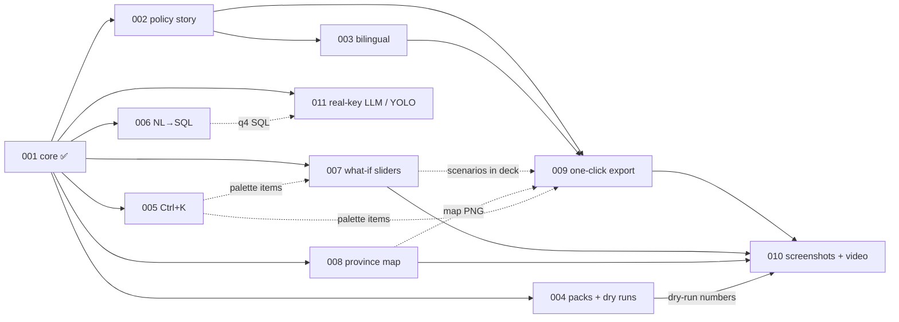

# Specs index (Spec Kit layout — github/spec-kit, MIT)

Each feature has its own folder with `spec.md` (user stories P1–P3, Given/When/Then, FR/NFR, success criteria, edge cases,
`[NEEDS CLARIFICATION]`), `plan.md` (technical context, constitution check, files to touch, OSS reuse + licence, security per
OWASP Top 10 / OWASP LLM Top 10), `tasks.md` (T-numbered, `[P]`, dependencies, test-first, done criteria, commit/push step) and
`contracts/` when an API or tool contract changes. Gates: [`.specify/memory/constitution.md`](../.specify/memory/constitution.md).
Day-by-day schedule: [`docs/ROADMAP.md`](../docs/ROADMAP.md).

Status legend: ✅ done & pushed · 🟡 spec ready (not started) · 🔵 in progress. Roles (from `docs/CONTEST_ANALYSIS.md` §4.1):
LEAD (team lead), DE (data engineer — today the only coder), AN (analyst), PO (policy owner / main speaker), ST (storyteller/deck), RQ (research & QA).
Hours are single-developer estimates for the 2-CPU laptop, written 2026-11-16 (not measurements).

| # | Feature | Contest priority | Status | Owner role | Est. h | Depends on | Tasks |
|---|---|---|---|---|---|---|---|
| [001](001-vietleap-insight-kit/) | VietLeap Insight Kit core (DE pipeline, insight engine, web, AI, deck, security, CI) | — | ✅ core done (last: T043–T045 `7ecc309`) | DE | — | — | T001–T077 |
| [002](002-policy-question-story/) | Policy-question-first story & deck (decision → evidence → limitation) | **P1** (rubric A + D) | 🔵 Phase A (deck + pitch) `bdcb571`; Phase B (API + web story) in progress | DE + PO | 5 | 001 | T201–T212 |
| [003](003-bilingual-deck/) | Bilingual deck/pitch `--lang vi\|en\|both` | **P1** (risk R6) | 🟡 | DE + ST | 4 | 002 (layout; strings can start in parallel) | T301–T312 |
| [004](004-scenario-packs/) | Scenario packs: provincial public finance, listed firms, WDI VN vs ASEAN, energy/EV; dry-run checklist | **P1** (themes ~80% of likely briefs) | 🟡 | DE + RQ + AN | 7 | 001 | T401–T413 |
| [009](009-one-click-export/) | One-click "Xuất báo cáo" (deck + pitch + dashboard PDF + bundle) | **P1** (submission 21/11 13:00) | 🟡 | DE + ST | 5 | 002, 003 (007/008 optional) | T901–T911 |
| [011](011-real-key-validation/) | Real-key LLM test (+ optional YOLO real run) | **P1** LLM / P3 YOLO | 🟡 | LEAD/DE + AN | 3 (+2) | 001 (006 for q4) | T1101–T1110 |
| [007](007-whatif-sliders/) | What-if sliders page (multi-driver, joint CI90) | P2 | 🟡 | DE + AN | 4 | 001 | T701–T711 |
| [008](008-province-choropleth/) | 34-province choropleth → Hỏi AI | P2 | 🟡 | DE + RQ | 5 | 001 (boundary licence gate T801) | T801–T811 |
| [005](005-command-palette/) | Ctrl+K command palette (shadcn Command/cmdk) | P2 | 🟡 | DE | 2.5 | 001 | T501–T508 |
| [006](006-nl-to-sql/) | NL→SQL in AI Analyst (read-only guard, inline chart, cited query, offline templates) | P2 | 🟡 | DE + AN | 5 | 001 (T061 done) | T601–T612 |
| [010](010-screenshots-demo-video/) | Screenshots + 90 s demo video script | P2 | 🟡 | ST + DE | 3 | best after 005/007/008/009 | T1001–T1008 |

Total remaining ≈ 43.5 h (+2 h optional YOLO) — more than the ≈ 30 developer-hours available before 19/11 12:00, so
[`docs/ROADMAP.md`](../docs/ROADMAP.md) draws a cut line: P1 rows first; P2 rows in table order until the 18/11 freeze.

## Dependency graph

## Conventions
- Task ids are unique across features (feature *NNN* uses T*N*01…). Tick `[x]` with the commit hash in the same push.
- One task group = one commit as `thanhdicode`; run `pytest -q tests`, then `cd web && npm test && npm run lint && npm run build` sequentially; push to `origin main`.
- Contracts in `specs/<feature>/contracts/` are fragments; the canonical API document stays `specs/001-vietleap-insight-kit/contracts/openapi.json`, regenerated by `python tools/export_openapi.py` (CI checks drift).

- Trả lời câu hỏi mở (dữ liệu ngân sách tỉnh, license, bản đồ, video YOLO, thể thức thi mặc định): ../docs/RESEARCH_OPEN_QUESTIONS.md
